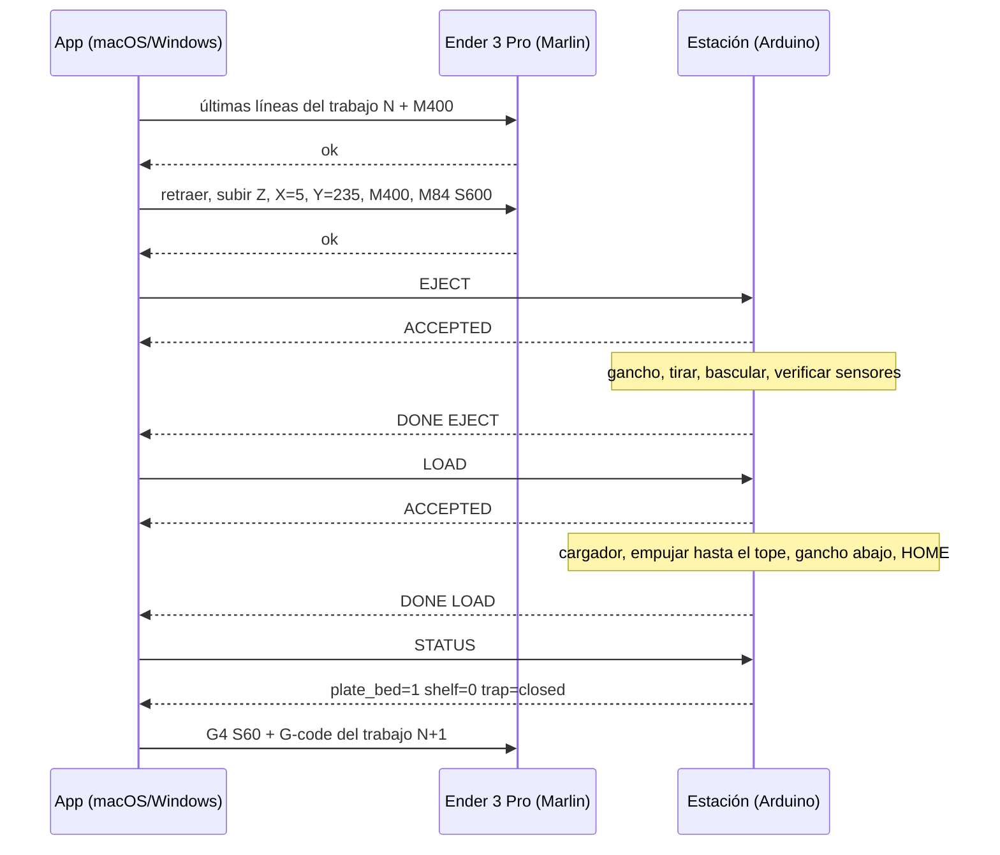
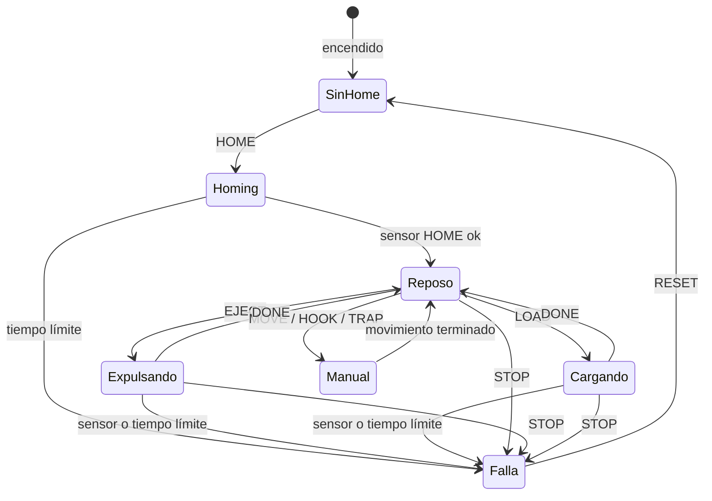
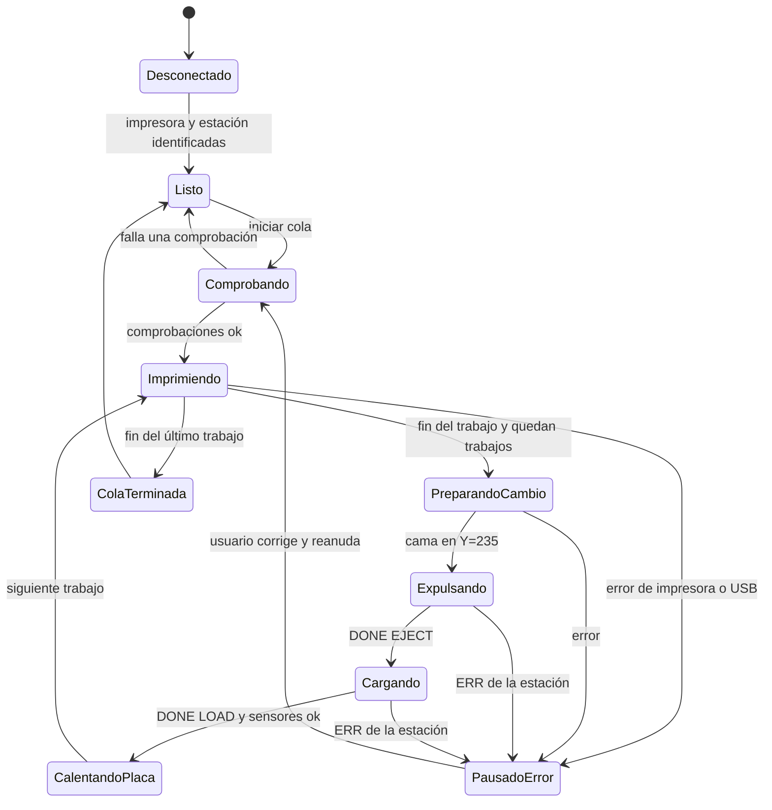

# Plan Detallado: AutoSwap para Creality Ender 3 Pro (v2)

> **Qué es este documento.** Es el plan maestro para replicar en una **Creality Ender 3 Pro** la función del **[Kit AutoSwap A1 de Nel 3D](https://nel-3d.com/products/autoswap-completo-a1)** (diseño original de **EVRENOT**, [Cults3D](https://cults3d.com/en/3d-model/tool/autoswap-bambulab-a1-plate-changer-upgrade-kit-v1)), analizado en el video **[Convierte tu Impresora 3D en una Máquina Automática 24/7](https://www.youtube.com/watch?v=CNrtmL0N2PQ)**. Incluye: cómo funciona el original, una auditoría del material que ya existe en este repositorio, el diseño propuesto para la Ender 3 Pro, la lista de compras, instrucciones de armado para personas con pocos conocimientos de electrónica y el plan de desarrollo del software en **macOS y Windows**.
>
> **Relación con los documentos anteriores.** Este plan **revisa y reemplaza** la parte mecánica y de software de `README.md`, `INVESTIGACION_AUTOSWAP_A1_A_ENDER3PRO.md`, `TUTORIAL_INSTALACION.md` y su PDF. La sección 1 explica por qué: la secuencia mecánica descrita ahí no puede funcionar en una impresora de cama móvil como la Ender 3 Pro.

---

## Índice

0. [Resumen ejecutivo](#0-resumen-ejecutivo)
1. [Auditoría del proyecto actual](#1-auditoría-del-proyecto-actual)
2. [Cómo funciona el AutoSwap A1 original](#2-cómo-funciona-el-autoswap-a1-original)
3. [La física de una impresora de cama móvil (la clave de todo el diseño)](#3-la-física-de-una-impresora-de-cama-móvil-la-clave-de-todo-el-diseño)
4. [Bambu Lab A1 vs. Ender 3 Pro: qué cambia](#4-bambu-lab-a1-vs-ender-3-pro-qué-cambia)
5. [Alternativas evaluadas y decisión](#5-alternativas-evaluadas-y-decisión)
6. [Diseño recomendado: Estación de Cambio Frontal (ECF)](#6-diseño-recomendado-estación-de-cambio-frontal-ecf)
7. [Lista de compras (BOM)](#7-lista-de-compras-bom)
8. [Instrucciones de armado para principiantes](#8-instrucciones-de-armado-para-principiantes)
9. [Plan de desarrollo de software (macOS y Windows)](#9-plan-de-desarrollo-de-software-macos-y-windows)
10. [Plan de proyecto por fases y criterios de aceptación](#10-plan-de-proyecto-por-fases-y-criterios-de-aceptación)
11. [Solución de problemas](#11-solución-de-problemas)
12. [Glosario para principiantes](#12-glosario-para-principiantes)
13. [Fuentes y nivel de confianza](#13-fuentes-y-nivel-de-confianza)
- [Anexo A: Hoja de mediciones de tu impresora](#anexo-a-hoja-de-mediciones-de-tu-impresora)
- [Anexo B: Plantillas de G-code para el laminador](#anexo-b-plantillas-de-g-code-para-el-laminador)
- [Anexo C: Protocolo completo de la estación](#anexo-c-protocolo-completo-de-la-estación)
- [Anexo D: Archivo de configuración de ejemplo](#anexo-d-archivo-de-configuración-de-ejemplo)

---

## 0. Resumen ejecutivo

**Objetivo.** Que la Ender 3 Pro imprima una cola de trabajos sin intervención: al terminar cada pieza, retirar la placa PEI usada (con la pieza encima) y colocar una placa limpia, sin esperar a que la cama se enfríe, igual que hace el AutoSwap en la Bambu Lab A1.

**Cinco conclusiones del análisis:**

1. **El AutoSwap A1 es un sistema mecánico sin electrónica.** Guarda hasta 10 placas de repuesto (más 1 en la cama = 11 trabajos seguidos), usa un **hilo de pesca trenzado dentro de un tubo PTFE** conectado al sistema de movimiento de la impresora y se activa con **cambios en el G-code** generados por la web [auto-swap.net](https://auto-swap.net/). No necesita alimentación externa.
2. **En una impresora de cama móvil ("bed slinger"), la cama sola no puede meter ni sacar una placa.** Si la placa va pegada a la cama por los imanes, se mueve con ella; para que la placa se desplace *respecto de la cama* hace falta **un elemento fijo que la sujete o la empuje** mientras la cama se mueve, y **un actuador de carrera larga** (≥ 235 mm, el largo de la placa). En la A1, todo indica que esa carrera larga la aporta el **eje Z** a través del hilo (por eso, en la versión 1, el cabezal tenía que subir "hasta arriba del todo").
3. **La secuencia descrita en los documentos actuales del repositorio no cumple esa condición** (la cama "arrastra" la placa nueva sin ningún elemento fijo, las "cuñas" fijas chocarían durante la impresión y la placa expulsada caería sobre el chasis). También faltan los modelos 3D de las piezas y el software no tiene control de lazo cerrado. Hay que rediseñar (detalle en la sección 1).
4. **Recomendación: una Estación de Cambio Frontal (ECF).** Un módulo independiente que se coloca delante de la impresora con **un eje lineal propio (motor paso a paso NEMA 17)**, **un gancho y una bandeja basculante movidos por servos**, **un cargador de placas** y **cuatro sensores**. La impresora solo lleva la cama a la posición de cambio. La electrónica es **Arduino UNO + CNC Shield V3** (se arma sin soldar) y una **app de escritorio para macOS y Windows** controla la impresora y la estación por USB. **No requiere modificar el firmware de la Ender 3 Pro.**
5. **Costo y esfuerzo estimados:** ~230–460 USD en materiales (con 4 placas; cada placa extra ~10–20 USD; menos si ya tienes filamento, cables o un kit Arduino), de 6 a 10 semanas a tiempo parcial para una persona principiante, siguiendo las fases de la sección 10. El ciclo de cambio estimado es de **2–3 minutos** (contra 30–45 minutos de enfriamiento del método "auto-eject").

**Cómo leer este documento según tu interés:**

| Si quieres... | Ve a |
| :--- | :--- |
| Entender el AutoSwap original | Secciones 2 y 3 |
| Saber qué está mal en lo que ya existe | Sección 1 |
| Ver el diseño para la Ender 3 Pro | Sección 6 |
| Comprar las piezas | Sección 7 |
| Armar el dispositivo paso a paso | Sección 8 |
| Programar la app y el firmware | Sección 9 |
| Organizar el trabajo por semanas | Sección 10 |

### 0.1 Estado de verificación de este análisis

Para ser transparentes con lo que se pudo comprobar en esta revisión:

| Información | Estado |
| :--- | :--- |
| Contenido del repositorio (todos los archivos) | **Revisado completo**, línea por línea |
| Datos del producto (capacidad 10+1, hilo trenzado + PTFE, sin alimentación externa, cambios de G-code) | **Confirmado** con fuentes públicas: [Fabbaloo](https://www.fabbaloo.com/news/design-of-the-week-autoswap-bambu-lab-a1-plate-changer), [Cults3D](https://cults3d.com/en/3d-model/tool/autoswap-bambulab-a1-plate-changer-upgrade-kit-v1), [Nel 3D](https://nel-3d.com/products/autoswap-completo-a1), [auto-swap.net](https://auto-swap.net/) |
| Diferencias V1 / V2 del diseño de EVRENOT (imanes, problema del eje Z) | **Confirmado** con la ficha de Cults3D |
| Minutajes y detalles finos del video `CNrtmL0N2PQ` | **No reverificado**: el video no fue accesible desde el entorno de esta revisión. Se usan los minutajes del análisis previo del repositorio y se marcan como tales |
| Mecanismo interno exacto del A1 (qué pieza mueve el hilo) | **Inferido** a partir de los datos confirmados (ver 2.5). Verificable con el [video oficial de montaje](https://www.youtube.com/watch?v=SVQRO_UR8Ic) y los archivos 3MF |
| Dimensiones de tu Ender 3 Pro concreta | **Debes medirlas** (Anexo A). Hay revisiones de la máquina con diferencias de placa base, cama y tornillería |

---

## 1. Auditoría del proyecto actual

### 1.1 Qué contiene hoy el repositorio

| Archivo | Contenido | Valoración |
| :--- | :--- | :--- |
| `README.md` | Análisis del video, comparativa de sistemas, diferencias A1 vs Ender, BOM, cableado, firmware, macro G-code y script Python | Buena base de contexto; la mecánica y el software deben rehacerse |
| `INVESTIGACION_AUTOSWAP_A1_A_ENDER3PRO.md` | Análisis cronológico del video y matriz de adaptación | Útil como contexto; contiene datos que no corresponden a la versión actual del diseño (ver 1.3) |
| `TUTORIAL_INSTALACION.md` y `Tutorial_Instalacion_AutoSwap_Ender3Pro.pdf` | Tutorial de 6 fases (el PDF es el mismo texto) | Pide imprimir piezas que **no existen** en el repositorio |
| `autoswap_esp32.cpp`, `platformio.ini` | Firmware ESP32: servo MG996R + 2 finales de carrera, comandos `STATUS/ENGAGE/RELEASE/TEST_CYCLE` | Funciona como demo; no sirve como controlador fiable (ver 1.3) |
| `autoswap_manager.py`, `requirements.txt` | CLI Python: `ports`, `merge`, `bridge`, `test` | Buena idea de partida; solo macOS y en lazo abierto (ver 1.3) |
| `ender3pro_autoswap_macro.gcode` | Secuencia de cambio con `M118 //AUTOSWAP:*` | Depende de la mecánica no viable |
| `LICENSE` | MIT | Correcto |

### 1.2 Lo que está bien y se conserva

- Sustituir la alfombrilla blanda *C-Mag* por **placas de acero para muelles con PEI de 235 × 235 mm**: imprescindible, una placa rígida es la única que se puede empujar y tirar.
- Cambiar los muelles de la cama por **espaciadores rígidos de silicona**: la cama no debe cabecear cuando se empuja o tira de la placa.
- Usar un **microcontrolador** con sensores para confirmar cada paso, y **pySerial** en el ordenador.
- La idea de que el ordenador **coordine la impresora y el cambiador** por USB.
- Detectar que el eje Z de la Ender 3 Pro es lento (husillo T8, ~5 mm/s de velocidad máxima de fábrica) y no conviene usarlo como actuador en cada cambio.

### 1.3 Problemas encontrados

**Problemas mecánicos (bloqueantes):**

| # | Problema | Por qué no funciona | Consecuencia |
| :--- | :--- | :--- | :--- |
| M1 | "La cama retrocede, acopla los imanes de la placa nueva y al avanzar la extrae del cargador" (Etapas 3–4) | Si la placa nueva queda unida a la cama, se mueve **exactamente igual** que la cama: no hay movimiento relativo, la placa nunca "sube" a la cama. Si se une al borde trasero, queda colgando detrás de la cama | La placa nueva no se carga |
| M2 | "La cama avanza, unas cuñas levantan la placa usada y cae por gravedad a la bandeja frontal" (Etapa 2) | La placa está sujeta por la base magnética y se mueve con la cama; para que unas cuñas fijas se metan debajo, la placa tendría que sobresalir de la cama. Además, cuñas fijas a la altura de la placa **chocarían durante la impresión** cada vez que la cama va al frente | Choques durante la impresión; la placa no se despega |
| M3 | "Avanzar al máximo: la placa nueva empuja y expulsa la usada" (macro, Fase 3) | Con la cama en `Y=235`, la parte trasera del recorrido queda vacía: la placa nueva no tiene dónde apoyarse ni nada que la empuje. Y si la placa usada se empuja fuera de la cama en otra posición, cae sobre el perfil 4040, la correa o el motor Y | Placa sobre el chasis, riesgo de daño |
| M4 | Servo MG996R de 180° tirando del hilo para "liberar la placa" | Un servo con brazo de 2–3 cm tiene una carrera de ~4–6 cm. Mover una placa de 235 mm requiere **~5 veces más carrera** | El servo solo puede armar/soltar pestillos, no transportar placas |
| M5 | Imanes "20 × 10 × 2 mm" como especificación del original | Eso corresponde a la **versión 1** (10 × 20 × 2 mm). La **versión 2** del diseño de EVRENOT usa **16 imanes redondos de 12 × 3 mm** porque los cuadrados "perdían rendimiento con el tiempo" | Especificación desactualizada |
| M6 | Las "cinco familias de piezas impresas" del tutorial | No hay archivos STL/STEP/3MF en el repositorio y el diseño del A1 no encaja en la Ender (cama de 256 vs 235 mm, chasis distinto) | Nadie puede seguir el tutorial |
| M7 | Bastidor trasero "salvando el motor Y" | Detrás de la cama de la Ender 3 Pro están el motor Y, el final de carrera Y y la salida del cable de la cama caliente, que se mueve con la cama | Interferencias no analizadas |

**Problemas de software y electrónica:**

| # | Problema | Detalle |
| :--- | :--- | :--- |
| S1 | **Lazo abierto** | La impresora ejecuta `M118 //AUTOSWAP:ENGAGE`, espera un tiempo fijo (`G4 P1500`) y sigue moviéndose **aunque el puente Python no esté corriendo o el ESP32 haya fallado**. Si el cambio falla, la siguiente pieza se imprime encima de la anterior |
| S2 | `M118` antes de `M400` | En la macro, `M118` se ejecuta mientras aún hay movimientos en cola (`G1 X10`), es decir, antes de que el cabezal termine de aparcar |
| S3 | Abrir el puerto reinicia algunas placas | En la placa Creality 1.1.x (8 bits), abrir el puerto USB activa DTR y **reinicia la impresora**. Lanzar el modo `bridge` a mitad de una impresión desde la microSD la aborta |
| S4 | `M0` como pausa remota | Enviar `M0` por USB mientras se imprime desde la microSD no detiene la cola de la tarjeta de forma fiable y, sin `EMERGENCY_PARSER`, no se puede reanudar desde el host |
| S5 | Firmware bloqueante | `delay()` de 800–1500 ms, sin tiempos límite, sin parada de emergencia, servo siempre energizado (zumbido y calor) |
| S6 | Solo macOS | Rutas `/dev/cu.*`, instrucciones Homebrew; no hay nada para Windows (`COMx`, drivers, PowerShell) |
| S7 | `merge` copia los G-code completos | Mantiene el G-code final de cada trabajo (`M84` desactiva motores, `M104 S0`, y en perfiles Creality el "presentar pieza" con `G1 Y235`) y luego inserta la macro de cambio; mezcla `G91`/`G90` que también cambian el modo del extrusor |
| S8 | Identificación de puertos | La Ender 3 Pro y muchos ESP32/Arduino usan el mismo chip CH340 (mismo VID:PID 1A86:7523): no se pueden distinguir sin un "saludo" (handshake) |

**Problemas de documentación:**

- Se presentan como hechos detalles no verificados (minutajes finos, enlaces de AliExpress concretos, el "tiempo de armado de 75–90 minutos" de algo que aún no está diseñado).
- La afirmación "subir Z descalibra el pórtico X" es exagerada: el riesgo real es la **lentitud** (≈ 50 s para 250 mm a 5 mm/s) y el **esfuerzo** sobre el husillo si algo se atasca.

**Conclusión de la auditoría:** el repositorio tiene un buen análisis de contexto y una dirección correcta (placas PEI, cama rígida, microcontrolador + ordenador), pero el mecanismo propuesto no es físicamente viable y el software debe reescribirse con control de lazo cerrado y soporte para Windows. Las secciones siguientes explican el porqué y la solución.

---

## 2. Cómo funciona el AutoSwap A1 original

### 2.1 Contexto del video

En [Convierte tu Impresora 3D en una Máquina Automática 24/7](https://www.youtube.com/watch?v=CNrtmL0N2PQ), el canal **Nel 3D** (que opera una granja de impresoras) presenta sistemas sencillos y económicos para que una impresora produzca de forma continua. Según el análisis previo de este repositorio (minutajes no reverificados aquí):

| Sistema | Impresora | Costo aprox. | Principio | Punto fuerte | Límite |
| :--- | :--- | :--- | :--- | :--- | :--- |
| [SwapMod A1 Mini](https://nel-3d.com/products/kit-swapmod-a1-mini) | Bambu Lab A1 Mini | ~70 € | Cargador + expulsor de placas, accionado por los movimientos de la impresora | Montaje de 1–2 h, sin electrónica | Solo A1 Mini (180 × 180 mm) |
| [AutoSwap A1](https://nel-3d.com/products/autoswap-completo-a1) | Bambu Lab A1 | ~90–100 € | Cargador trasero de hasta 10 placas + recogida; hilo trenzado en tubo PTFE | 11 trabajos seguidos, cambio en segundos sin enfriar | Más piezas que imprimir (cama de 256 mm) |
| Auto-Eject | Cualquier impresora abierta | ~0 € | Inclinar la impresora (~35°) y empujar la pieza con el cabezal tras enfriar | Gratis | Espera de 30–45 min; falla con piezas planas o pequeñas; riesgo para el cabezal |
| Automat (Kickstarter) | Granjas, impresoras cerradas | Alto | Robot externo que abre la puerta y retira piezas | Sirve para ABS en cámara cerrada | Caro y voluminoso |

### 2.2 Datos confirmados del AutoSwap A1

| Dato | Valor | Fuente |
| :--- | :--- | :--- |
| Capacidad | **10 placas en el cargador + 1 en la cama** = 11 trabajos seguidos | [Fabbaloo](https://www.fabbaloo.com/news/design-of-the-week-autoswap-bambu-lab-a1-plate-changer) |
| Accionamiento | Un **hilo de pesca** conecta las piezas añadidas con el sistema de movimiento de la impresora; **no requiere alimentación externa** | Fabbaloo |
| Arquitectura | Un mecanismo retira la placa terminada y la deposita en un **contenedor**; en la parte **trasera** hay un **almacén de placas limpias** que se montan para el siguiente trabajo | Fabbaloo |
| Activación | **Pequeños cambios en el G-code** provocan los movimientos que activan el sistema | Fabbaloo |
| Materiales V1 | Hilo trenzado grueso de 15 lb (2 m), tubo PTFE (1 m), imanes **10 × 20 × 2 mm**, tornillos M3 | Ficha V1 en Cults3D |
| Materiales V2 | Hilo trenzado (2 m), tubo PTFE (1 m), **16 imanes redondos de 12 × 3 mm**, 2 tornillos M3 × 10 por placa, 10 tornillos M3 × 15, 15 cm de cinta espumada doble cara | [Ficha V2 en Cults3D](https://cults3d.com/en/3d-model/tool/autoswap-bambulab-a1-plate-changer-upgrade-kit-v1) |
| Cambios V2 | Rediseño completo, montaje simplificado, imanes redondos "más fuertes y duraderos" en lugar de cuadrados, y **corregido el problema por el que el eje Z llegaba a su altura máxima durante el cambio** | Ficha V2 en Cults3D |
| Software | [auto-swap.net](https://auto-swap.net/): une y gestiona archivos 3MF/G-code; eliges orden y número de copias ("clones") y descargas el archivo combinado. Soporta A1, Anycubic Kobra 3 y Creality Hi Combo | auto-swap.net |
| Kit comercial | Desde ~90 €; incluye el hardware y piezas excepto las piezas grandes (se imprimen con los STL incluidos); video de montaje de ~20 min | [Nel 3D](https://nel-3d.com/products/autoswap-completo-a1) |
| Otras plataformas | Existe versión para Anycubic Kobra 3 (hasta 10 impresiones seguidas); SimplyPrint lo integra y cuenta las placas para detener la cola cuando se acaban | [Cults3D Kobra 3](https://cults3d.com/en/3d-model/tool/autoswap-anycubic-kobra-3-plate-changer-upgrade-kit), [SimplyPrint](https://simplyprint.io/features/autoprint/autoswap) |

### 2.3 Modelo funcional: lo que cualquier cambiador de placas debe hacer

Independientemente de la marca, un cambiador de placas cumple seis funciones. Pensar en ellas por separado es lo que permite diseñar uno para otra impresora:

| # | Función | Pregunta de diseño |
| :--- | :--- | :--- |
| F1 | **Almacenar** placas limpias | ¿Dónde caben N placas sin estorbar a la impresión? |
| F2 | **Despegar** la placa usada de la base magnética | ¿Se pela (levantar un borde) o se desliza (cizalla)? |
| F3 | **Evacuar** la placa usada (con la pieza) a un contenedor | ¿Qué la mueve fuera de la cama y hacia dónde cae? |
| F4 | **Alimentar** una placa limpia hasta la cama | ¿Qué la transporta ~1 largo de placa? |
| F5 | **Alinear y asentar** la placa nueva | ¿Qué referencia fija su posición (topes, pines)? |
| F6 | **Secuenciar y verificar** | ¿Quién ordena los pasos y cómo se sabe que cada uno salió bien? |

### 2.4 El ciclo de cambio del A1, paso a paso (nivel funcional)

1. **Fin de impresión.** El G-code modificado por auto-swap.net no termina como uno normal: ejecuta una secuencia de movimientos especial.
2. **Armado del mecanismo.** Un movimiento que **nunca ocurre durante una impresión normal** (en la V1, subir el eje Z hasta su tope) tensa el hilo trenzado a través del tubo PTFE. Usar un movimiento "imposible" en impresión normal garantiza que el mecanismo no se dispare por accidente.
3. **Retirada de la placa usada** (F2 + F3). La placa, con la pieza todavía caliente y adherida, se separa de la base magnética y se deposita en el contenedor. Las piezas se sueltan solas al enfriarse fuera de la impresora.
4. **Carga de la placa limpia** (F4 + F5). Una placa del almacén trasero se transporta hasta la cama y queda alineada.
5. **Siguiente trabajo.** El archivo combinado continúa con el siguiente trabajo (calentar, homing, imprimir).
6. **Fin de la cola.** Cuando se acaban las placas, se acaba el archivo; el usuario vacía el contenedor, despega las piezas y recarga el almacén.

El tiempo de cambio mostrado en el video es de segundos (según el análisis previo, menos de 15 s), frente a los 30–45 minutos de espera del método Auto-Eject.

### 2.5 El mecanismo interno: interpretación razonada (inferencia)

> Esta subsección es una **inferencia** que encaja con todos los datos confirmados de 2.2; no se ha verificado pieza por pieza. Se puede comprobar viendo el [video oficial de montaje](https://www.youtube.com/watch?v=SVQRO_UR8Ic) o abriendo los archivos 3MF.

- La A1 es una impresora de **cama móvil** como la Ender 3 Pro. Como se explica en la sección 3, en este tipo de máquina hace falta un actuador que mueva la placa **unos 25 cm respecto del chasis**.
- La A1 ya tiene un actuador de carrera larga que se puede "prestar": el **eje Z** (~256 mm de recorrido vertical). Un **cable Bowden** (hilo dentro de un tubo PTFE, como el freno de una bicicleta) transforma el recorrido vertical del pórtico en un tirón horizontal en otro punto de la impresora, sin motores ni electrónica añadidos.
- Esto explica tres observaciones: (a) "si el cabezal no llega hasta arriba del todo, no se activa" (la carrera queda incompleta), (b) la V2 corrigió "que el eje Z llegara a su altura máxima" (seguramente con una relación de poleas o una carrera útil menor) y (c) basta con "pequeños cambios en el G-code" (solo hay que añadir movimientos de Z, X e Y).
- Los **imanes** acoplan y desacoplan piezas sin pestillos complicados, y las piezas de **ABS** atornilladas a cada placa (soportan el calor de la cama) son los puntos por donde el mecanismo agarra la placa.

### 2.6 Limitaciones conocidas del original

- **Depende de recorridos completos de los ejes**: un fallo de homing o un tope mal calibrado deja el ciclo a medias.
- **Sensible al espesor** de las placas (las clónicas varían) y al adhesivo de la base magnética.
- **Imanes cuadrados V1** que pierden fuerza con el tiempo (corregido en V2).
- **Sin sensores**: si un cambio falla, la siguiente pieza puede imprimirse sobre la anterior. SimplyPrint añade conteo de placas, no verificación física.
- **Exclusivo de la geometría de la A1** (cama de 256 × 256 mm, chasis de la A1).

---

## 3. La física de una impresora de cama móvil (la clave de todo el diseño)

Esta sección es corta pero es la más importante: explica por qué el diseño anterior no funciona y de dónde sale el diseño recomendado.

### 3.1 La zona barrida

En la Ender 3 Pro, la **boquilla no se mueve en Y**: siempre está en el mismo punto del chasis. Lo que se mueve hacia adelante y hacia atrás es la **cama** (235 mm de recorrido). Si medimos posiciones en el chasis con la boquilla en `f = 0`:

```
Vista lateral (eje Y). La boquilla/pórtico está fija en f = 0.

  ATRÁS                                                                    ADELANTE
  f (mm):  -470        -235                0                +235             +470
            |-----------|==================|=================|----------------|
            |  ZONA     |        ZONA BARRIDA por la cama y las piezas       |  ZONA      |
            |  LIBRE    |                                                    |  LIBRE     |
            |  TRASERA  | [====== cama en Y=0 ======]                        |  FRONTAL   |
            |           |                  [====== cama en Y=235 ======]     |            |
                                           ^
                                   boquilla y pórtico Z
```

- Con `Y = 0` (homing), la cama está **totalmente atrás** y ocupa de `f = -235` a `f = 0`.
- Con `Y = 235`, la cama está **totalmente adelante** y ocupa de `f = 0` a `f = +235`.
- Toda la franja de `-235` a `+235` la recorre la cama **con las piezas encima** durante cualquier impresión: es la **zona barrida**. Nada fijo puede ocupar esa franja a la altura de la cama o de las piezas.

### 3.2 Seis reglas que salen de la física

| Regla | Enunciado | Consecuencia práctica |
| :--- | :--- | :--- |
| **R1. Movimiento relativo** | Una placa pegada a la cama por imanes se mueve con ella. Para que la placa se desplace *respecto de la cama*, algo **fijo** (o con motor propio) debe sujetarla o empujarla mientras la cama se mueve | "La cama arrastra la placa nueva" no funciona si nada la retiene |
| **R2. Dónde puede haber piezas fijas** | Solo en las **zonas libres** (delante de `+235` o detrás de `-235`), a los **lados** de la cama, por **encima de la pieza más alta**, o bien piezas **retráctiles** que solo aparecen durante el cambio | Cuñas fijas a la altura de la placa dentro de la zona barrida chocan durante la impresión |
| **R3. Carrera larga** | Para sacar o meter una placa hay que desplazarla **≥ 235 mm** respecto del chasis | Un servo de 180° no basta; hace falta un eje lineal (motor + correa/husillo) o "prestar" un eje de la impresora |
| **R4. Pelar cuesta menos que deslizar** | Despegar levantando un borde (pelado) necesita poca fuerza; deslizar la placa entera sobre el imán (cizalla) necesita bastante más (estimado 5–20 N; **hay que medirlo**, sección 6.5) | Conviene levantar ligeramente el borde al tirar, y medir la fuerza antes de elegir motor |
| **R5. Armado seguro** | Todo lo que actúa sobre la placa debe estar **desarmado durante la impresión** y armarse solo en el cambio (en la A1, subir Z al tope; aquí, un servo o un eje que solo se mueve en el cambio) | Evita disparos accidentales a mitad de una pieza |
| **R6. Caída segura** | La placa usada solo puede soltarse donde no haya chasis debajo: en la zona libre frontal o trasera | Una placa soltada dentro de la zona barrida cae sobre el perfil 4040, la correa o el motor Y |

### 3.3 Aplicando las reglas al diseño anterior

- **Etapas 3–4 (cargar arrastrando con la cama):** incumple **R1**. La placa nueva nunca se desplaza respecto de la cama.
- **Etapa 2 (cuñas que levantan la placa al avanzar):** incumple **R2** (cuñas fijas en la zona barrida) y **R1** (nada retiene la placa).
- **Fase 3 de la macro (la placa nueva empuja a la usada):** incumple **R3** (nada aporta la carrera de 235 mm) y **R6** (la usada caería sobre el chasis).
- **Servo como transporte:** incumple **R3**.

### 3.4 Cómo se cumple cada regla en el diseño recomendado

En la Estación de Cambio Frontal (sección 6), **todo el mecanismo vive en la zona libre frontal** (R2, R6), un **eje lineal propio** aporta la carrera larga (R1, R3), un **gancho retráctil** solo se levanta durante el cambio (R5) y al tirar de la placa se le levanta ligeramente el borde delantero (R4).

---

## 4. Bambu Lab A1 vs. Ender 3 Pro: qué cambia

| Aspecto | Bambu Lab A1 | Creality Ender 3 Pro | Implicación para el diseño |
| :--- | :--- | :--- | :--- |
| Cama / área de impresión | 256 × 256 mm | Cama de 235 × 235 mm, área útil 220 × 220 × 250 mm | Placas de 235 × 235 mm; todo se redimensiona |
| Superficie de fábrica | Placa de acero flexible con PEI | Alfombrilla magnética blanda *C-Mag* | Cambiar a placas de acero PEI (rígidas, deslizan) |
| Fijación de la placa | Base magnética + pines traseros de alineación | Solo base magnética | Añadir un **tope trasero** como referencia de alineación |
| Nivelación | Automática, cama fija | 4 ruedas con muelles | Espaciadores rígidos; nivelar una vez |
| Eje Y | Base cerrada | Perfil V-Slot 4040 abierto; motor Y y final de carrera atrás; cable de cama que se mueve | Evitar la zona trasera; trabajar por delante |
| Eje Z | Rápido | Un husillo T8, ~5 mm/s máx. de fábrica (≈ 50 s para 250 mm) | No usar Z como actuador en cada cambio |
| Placa base / firmware | Propietario | Creality 1.1.x (8 bits, ATmega1284P) o 4.2.2/4.2.7 (32 bits), Marlin | No tocar el firmware: controlar por USB desde el ordenador |
| Conexión con el ordenador | Wi-Fi/nube, Bambu Studio | USB (chip CH340) a 115200 baudios, o microSD | El ordenador actúa como "host" de impresión |
| Zona frontal | — | Tensor de la correa Y (bajo), pantalla LCD al frente-derecha según revisión | La estación se centra delante de la cama, por encima del tensor |

---

## 5. Alternativas evaluadas y decisión

| Criterio (1 = malo, 5 = muy bueno) | A. Mecánica pura (Z + hilo, copia del original) | B. Diseño previo del repo (servo + cuñas + cama) | **C. Estación de Cambio Frontal (recomendada)** | D. Auto-Eject (sin cambio de placa) |
| :--- | :---: | :---: | :---: | :---: |
| Viabilidad física | 3 | 1 | **5** | 4 |
| Fiabilidad esperada | 2–3 | 1 | **4** | 2–3 |
| Facilidad para principiante | 2 | 3 | **3** | 5 |
| Costo | 5 | 4 | **3** | 5 |
| Tiempo de ciclo | 2 (≈ 3–4 min) | — | **4 (≈ 2–3 min)** | 1 (30–45 min) |
| Riesgo para la impresora | 3 (esfuerzo en el husillo Z) | 3 | **5 (todo fuera de la impresora)** | 2 (el cabezal empuja piezas) |
| Cambios en la impresora | Medios | Medios | **Mínimos y reversibles** | Ninguno |
| Se puede probar sin la impresora | No | No | **Sí (en banco)** | — |

**A. Mecánica pura.** Replicar el truco del A1 en la Ender: el pórtico Z tira de un cable Bowden que mueve un carro en una estación. Es elegante y barato, pero en la Ender 3 Pro el eje Z es lento, la carrera disponible (250 mm) es justa para una placa de 235 mm más holguras, el husillo puede generar fuerzas muy grandes si algo se atasca (hace falta un "fusible" mecánico) y secuenciar gancho y bandeja con levas es difícil de ajustar para un principiante. Se deja como variante para personas con experiencia.

**B. Diseño previo.** Descartado por los motivos de la sección 1.3.

**C. Estación de Cambio Frontal.** Un módulo aparte, en la zona libre frontal, con eje lineal propio, que solo necesita que la impresora deje la cama en `Y = 235`. Se puede construir y probar sobre la mesa antes de acercarlo a la impresora, y si algo falla la impresora no sufre. **Es la opción elegida.**

**D. Auto-Eject.** Útil como plan B o para piezas altas y robustas, pero no cumple el objetivo (cambio sin esperar enfriamiento).

**E. Futuro (avanzado).** Con una Raspberry Pi se puede integrar la estación en OctoPrint (plugin) o en Klipper (macros); la sección 10 lo deja como fase opcional.

---

## 6. Diseño recomendado: Estación de Cambio Frontal (ECF)

### 6.1 Idea general

La ECF es un módulo que se coloca **delante de la Ender 3 Pro, a la altura de la cama**. Cuando termina una pieza:

1. La impresora sube la boquilla y lleva la cama al frente (`Y = 235`).
2. Un **carro con un gancho**, que corre por un **eje lineal propio**, engancha la **zapata** (una pieza impresa atornillada al borde delantero de cada placa) y **tira** de la placa usada hasta una **bandeja**.
3. La bandeja **bascula** y la placa (con la pieza) cae a una **caja de recogida** lateral.
4. El carro va al **cargador**, engancha la zapata de la placa limpia de abajo de la pila y la **empuja** sobre la bandeja hasta la cama, donde se detiene contra un **tope trasero**.
5. El gancho baja, el carro vuelve a su posición de reposo y la impresora empieza el siguiente trabajo.

Todo el mecanismo está en la **zona libre frontal** (regla R2): durante la impresión nada toca la cama ni las piezas.

```
VISTA LATERAL - cama en Y = 235 (posición de cambio). Medidas aproximadas, f = posición en el chasis.

            portico Z (boquilla aparcada arriba)
                  |
  TOPE            |                         ESTACION DE CAMBIO FRONTAL (ECF)
  TRASERO         v               +---------------------------------------------------------------+
    #   +----------------------+  |   ZONA DE DESCARGA                ZONA DEL CARGADOR            |
    #   | placa PEI en la cama |Z=|                                   +------------------+         |
    #===+======================+==|== bandeja basculante (servo) =====| pila de placas   |== tope  |
        |  CAMA Ender 3 Pro    |  |                                   | (salen por abajo)|         |
        +----------------------+  |   <===== carro + gancho ===== eje lineal NEMA 17 =====> [HOME]  |
                                  +---------------------------------------------------------------+
    f = 0                  f ~ +245  f ~ +250                         f ~ +500             f ~ +790

    Z= : zapata (pieza impresa en el borde delantero de cada placa, con una ranura para el gancho)
```

```
VISTA SUPERIOR

             Ender 3 Pro                         ESTACION DE CAMBIO FRONTAL
    +--------------------------+   +-------------------------------+---------------------------+
    |                          |   | BANDEJA BASCULANTE            | CARGADOR                  |
    |  cama 235 x 235          |   | mitad izq. fija | mitad der.  | guias en las 4 esquinas   |
    |  placa PEI          [Z]=====>|                 | se inclina  | placas apiladas           |
    |                          |   |======= canal central: eje lineal + carro + gancho =========|[HOME]
    |                          |   |                 |             |                           |
    +--------------------------+   +-------------------------------+---------------------------+
                                                     |
                                                     v
                                        CAJA DE RECOGIDA (a la derecha, a nivel de mesa)
```

### 6.2 Componentes y su función

| # | Componente | Función (F1–F6 de la sección 2.3) | Descripción |
| :--- | :--- | :--- | :--- |
| 1 | **Placas PEI 235 × 235 mm** | — | Acero para muelles con PEI liso o texturizado. Preferible con **lengüeta frontal** (pestaña que sobresale del borde); si no la tienen, ver la variante en 6.7 (DR1) |
| 2 | **Zapata** (1 por placa) | F2, F3, F4 | Pieza de ABS/ASA atornillada a la lengüeta con 2 tornillos M3. Tiene una **ranura inferior** donde entra el dedo del gancho: sirve para tirar y para empujar |
| 3 | **Tope trasero** | F5 | Pieza de ABS/ASA sujeta al borde trasero de la cama (centrada, lejos de la salida del cable de la cama). La placa nueva se empuja hasta tocarlo: define su posición en Y |
| 4 | **Cama rígida** | F5 | Espaciadores de silicona en lugar de muelles: la cama no cede al empujar |
| 5 | **Eje lineal** (~550–600 mm de carrera) | F3, F4 | Motor NEMA 17 con correa GT2 (o husillo). Aporta la carrera larga (regla R3) |
| 6 | **Carro con gancho** | F2, F3, F4 | Un servo pequeño (MG90S) levanta un dedo que entra en la ranura de la zapata. El esfuerzo de tirar/empujar va contra un **tope del carro**, no contra los engranajes del servo |
| 7 | **Bandeja basculante** | F3 | Dos mitades a la altura de la cama: la izquierda es fija; la derecha gira con un servo MG996R. Superficie con cinta de PTFE para que la placa deslice |
| 8 | **Cargador** | F1, F4 | Pila de 6–10 placas con guías en las esquinas. Una **ranura de salida** baja solo deja pasar la placa de abajo |
| 9 | **Caja de recogida** | F3 | Caja con espuma al lado derecho de la estación, a nivel de mesa |
| 10 | **Sensores** (finales de carrera) | F6 | `HOME` del carro; `PLACA_EN_CAMA` (la zapata lo pulsa cuando hay placa asentada y la cama está en `Y=235`); `PLACA_EN_BANDEJA`; `CARGADOR_CON_PLACAS`; opcional `BANDEJA_CERRADA`; botón de `STOP` |
| 11 | **Controlador** | F6 | Arduino UNO + CNC Shield V3 + driver TMC2209 (o A4988), fuente de 12 V y reductor a 5,5 V para los servos |
| 12 | **App de escritorio** (macOS/Windows) | F6 | Envía los trabajos a la impresora línea por línea y ordena el cambio entre trabajos, verificando cada sensor (sección 9) |

### 6.3 Secuencia completa del cambio

**Condiciones previas** (la app las comprueba antes de empezar la cola): estación en `HOME`, gancho abajo, bandeja cerrada, cargador con placas, placa asentada en la cama.

| Paso | Quién | Acción | Confirmación | Tiempo límite |
| :---: | :--- | :--- | :--- | :---: |
| 1 | App | Detecta el fin del trabajo: todas las líneas enviadas tienen `ok` y un `M400` final responde `ok` | `ok` de `M400` | según trabajo |
| 2 | Impresora | Retrae filamento; sube Z a `max(Z_actual + 10, Z_máx_del_trabajo + 10)` (máx. 250); aparca X en `X=5`; lleva la cama a `Y=235`; `M400`; `M84 S600` (motores energizados durante el cambio) | `ok` de `M400` | 120 s |
| 3 | Estación | Comprueba `PLACA_EN_CAMA` = pulsado (hay placa usada) | sensor | 1 s |
| 4 | Estación | **EXPULSAR**: gancho abajo → carro hasta `s_bed` (rápido y, en los últimos 20 mm, lento) → gancho arriba (entra en la ranura de la zapata) | posición + 300 ms | 20 s |
| 5 | Estación | Tira de la placa a 25 mm/s hasta `s_drop` (la placa sale de la cama y queda sobre la bandeja) | `PLACA_EN_BANDEJA` pulsado y `PLACA_EN_CAMA` liberado | 25 s |
| 6 | Estación | Gancho abajo → bandeja se inclina (1,5 s) → la placa cae a la caja → bandeja vuelve | `PLACA_EN_BANDEJA` liberado y `BANDEJA_CERRADA` | 10 s |
| 7 | Estación | **CARGAR**: comprueba `CARGADOR_CON_PLACAS`; carro hasta `s_mag`; gancho arriba (entra en la ranura de la zapata de la placa de abajo) | sensor + posición | 15 s |
| 8 | Estación | Empuja la placa a 25 mm/s por la bandeja hasta 15 mm antes de `s_bed`, y luego a 8 mm/s hasta que la placa toca el tope trasero | `PLACA_EN_CAMA` pulsado (o posición máx. `s_bed + 3` → error) | 40 s |
| 9 | Estación | Gancho abajo → carro a `HOME` | `HOME` | 15 s |
| 10 | App | Verifica estado final (placa en cama, bandeja vacía y cerrada); descuenta una placa del cargador; `M117 AutoSwap OK` | `STATUS` | 2 s |
| 11 | Impresora | Espera de calentamiento de la placa nueva (`G4 S60`–`S90`, configurable); empieza el siguiente trabajo (su G-code inicial hace `G28` y calienta) | `ok` | — |

Si **cualquier** confirmación falla, la estación se detiene, la app **pausa la cola**, mantiene la impresora en un estado seguro (calentadores de la boquilla apagados, cama en espera) y muestra qué paso falló y cómo resolverlo. Nunca se empieza un trabajo sin confirmar `PLACA_EN_CAMA`.

**Tiempo estimado del ciclo:** ~70–90 s de movimientos + 60–90 s de calentamiento de la placa = **2–3 minutos**.



### 6.4 Posiciones del carro (se calibran, valores de ejemplo)

El carro mide su posición `s` en milímetros desde `HOME` (extremo lejano de la estación), creciendo hacia la impresora:

| Nombre | Valor de ejemplo | Significado |
| :--- | :---: | :--- |
| `s_home` | 0 mm | Reposo, fuera del alcance de la cama |
| `s_mag` | 15 mm | Dedo del gancho bajo la ranura de la zapata de la placa inferior del cargador |
| `s_drop` | 280 mm | Placa usada completamente sobre la bandeja |
| `s_bed` | 525 mm | Dedo del gancho bajo la ranura de la zapata de una placa asentada en la cama con `Y = 235` |

### 6.5 Fuerzas: qué hay que medir antes de diseñar

Las fuerzas reales dependen de tu base magnética y tus placas. **Mídelas** con una báscula colgante digital (de equipaje) antes de elegir motor y diseñar piezas:

| Prueba | Cómo hacerla | Valor esperado (estimación) | Criterio |
| :--- | :--- | :--- | :--- |
| **T1. Deslizar la placa** (`F_desl`) | Placa sobre la base magnética. Pega con cinta un hilo al borde delantero y tira **horizontalmente** con la báscula. Anota el pico. Repite en frío y con la cama a 60 °C | 5–20 N (0,5–2 kgf) | Ideal ≤ 15 N. Si pasa de 20 N, usar el eje de husillo o levantar más el borde al tirar |
| **T2. Pelar el borde** (`F_pelar`) | Tira **verticalmente** del borde delantero | 1–5 N | Solo informativo |
| **T3. Retención de la cama** (`F_ret`) | Impresora encendida, `M17` (motores energizados), cama en `Y=117`. Empuja la cama con la báscula **hasta 2 × F_desl** sin pasar de ahí | — | Aprobado si la cama no se mueve. Después, haz `G28` |
| **T4. Resistencia de la zapata** | Tira de una zapata montada hasta **3 × F_desl** | — | No debe deslizarse ni agrietarse |

Capacidad del eje lineal (referencia): un NEMA 17 de ~0,4 N·m con polea GT2 de 20 dientes (radio ≈ 6,4 mm) da ~60 N teóricos; con el driver a ~0,8 A y a 25 mm/s cabe esperar **20–35 N útiles**, suficiente si `F_desl ≤ 15 N`. Un módulo de husillo T8 da mucha más fuerza (más lento).

### 6.6 Mediciones de tu impresora

Antes de diseñar en CAD, completa la hoja del **[Anexo A](#anexo-a-hoja-de-mediciones-de-tu-impresora)** (altura de la cama sobre la mesa, posición del borde delantero de la cama en `Y=235`, espacio libre delante del chasis, posición de la pantalla LCD, holgura bajo la cama, etc.). Con esos datos se ajustan todas las cotas de la estación.

### 6.7 Reglas de diseño para el CAD

El diseño de las piezas impresas es una tarea del proyecto (fase 2, sección 10). Estas reglas aseguran que funcione:

| Regla | Pieza | Especificación |
| :--- | :--- | :--- |
| **DR1** | Zapata | ABS o ASA (PETG como mínimo). Fuera del área imprimible y **sin nada debajo de la placa dentro de la cama**. Altura máxima 2 mm sobre la superficie de la placa. Ancho ~40 mm, centrada. Ranura inferior de ~8 mm (en Y) × 6 mm (en X) para el dedo. Se aprieta a la lengüeta con 2 × M3 + tuercas. **Variante sin lengüeta:** colocar la placa desplazada 10 mm hacia el frente (sobresale 10 mm de la cama) y sujetar la zapata en ese voladizo; el tope trasero se adelanta 10 mm y en el laminador se reduce el fondo útil a ~210 mm |
| **DR2** | Tope trasero | ABS/ASA (la cama llega a 60–100 °C). Centrado, ~60 mm de ancho, lejos de la esquina por donde sale el cable de la cama. Cara de tope vertical a ras del borde trasero de la cama, sobresaliendo 1,5–2 mm sobre la base magnética. Sujeto con abrazadera y tornillos al borde de la cama, sin taladrar el calefactor |
| **DR3** | Bandeja | Superficie **0,3–0,8 mm por encima** de la base magnética de la cama (la placa "baja" a la cama, nunca choca contra su borde). Cinta de PTFE en la superficie. Borde de entrada con chaflán de 30°. Ranura central ≥ ancho de la zapata + 6 mm. La mitad que bascula gira ≥ 35° |
| **DR4** | Cargador | Guías en las 4 esquinas con 1 mm de holgura. Ranura de salida de ~1,5 mm de alto en los laterales (deja pasar 1 placa) con una muesca central para la zapata. Pared de tope en el extremo lejano. Escalón que compense que la pila es más gruesa del lado de las zapatas. Altura ajustable con tornillo |
| **DR5** | Carro y gancho | El dedo (PETG o aluminio) transmite la fuerza a un tope del carro. En posición "abajo", nada sobresale por encima del plano de la bandeja menos 3 mm. Cable del servo por cadena portacables |
| **DR6** | Unión con la impresora | Escuadras atornilladas al travesaño frontal de la Ender (tuercas en T para perfil serie 20). Patas regulables para ajustar la altura. Separación cama–bandeja de 5–10 mm |
| **DR7** | Seguridad | Sin aristas cortantes, correa cubierta, botón de STOP accesible desde el frente |
| **DR8** | Paramétrico | Diseñar en FreeCAD u Onshape con variables (tamaño y espesor de placa, altura de cama, carrera) y publicar STEP + STL en `cad/` |

### 6.8 Límites del sistema

- **Altura máxima de pieza:** la limita el espacio sobre la bandeja y la caja de recogida. Objetivo de diseño: **150 mm** (configurable). La app rechaza trabajos más altos.
- **Capacidad:** 1 placa en la cama + 6–10 en el cargador.
- **Materiales:** PLA y PETG sobre PEI. Para impresión desatendida no se recomienda ABS sin cerramiento.
- **Placa nueva fría:** hay que esperar a que se caliente (60–90 s) para una buena primera capa.
- **Ordenador:** en la primera versión, un ordenador (Mac o PC) debe estar encendido y conectado durante toda la cola. La app impide que entre en suspensión.

### 6.9 Riesgos y mitigaciones

| Riesgo | Probabilidad | Mitigación |
| :--- | :---: | :--- |
| La placa se tuerce al entrar o salir | Media | Guías y chaflanes; velocidad final lenta; sensor `PLACA_EN_CAMA` |
| La cama se desplaza al empujar | Media | Prueba T3; velocidad final de 8 mm/s; el `G28` al inicio de cada trabajo corrige cualquier desplazamiento |
| La zapata se afloja | Baja | Mordazas atornilladas; prueba T4; revisión periódica |
| Se rompe el servo del gancho | Baja | El esfuerzo va contra un tope (DR5) |
| La placa no cae al bascular | Media | PTFE, ángulo ≥ 35°, sensor `PLACA_EN_BANDEJA` |
| El cargador suelta dos placas | Media | Ranura de salida ajustable (DR4) |
| El ordenador se suspende o se desconecta el USB | Media | La app evita la suspensión; la estación se detiene sola si deja de recibir mensajes (watchdog) |
| Incendio en impresión desatendida | Baja, grave | Firmware con protección térmica activa, detector de humo, supervisar las primeras colas, no dejar la impresora sola fuera de casa |

---

## 7. Lista de compras (BOM)

> **Precios orientativos** en USD (tiendas en línea tipo AliExpress, Amazon o Mercado Libre). Conviértelos con el tipo de cambio del día; varían mucho por tienda y temporada. Todo se puede conectar **sin soldar**.

### 7.1 Para la impresora

| # | Componente | Especificación | Cant. | USD aprox. | Para qué sirve |
| :---: | :--- | :--- | :---: | :---: | :--- |
| P1 | Placas de acero PEI | 235 × 235 mm, lisas o texturizadas; **preferible con lengüeta frontal** | 4 para empezar (hasta 11) | 10–20 c/u | Superficies intercambiables |
| P2 | Base magnética | 235 × 235 mm, adhesiva (suele venir en el kit de placas) | 1 | 0–15 | Sujeta la placa a la cama |
| P3 | Espaciadores de silicona para cama | 16–18 mm, resistentes a la temperatura | 1 juego (4) | 5–8 | Cama rígida |
| P4 | Kit de tornillería M3 | Tornillos M3 × 8, 10, 12, 16 + tuercas + arandelas | 1 | 6–10 | Zapatas y tope trasero |
| P5 | Filamento ABS o ASA | 0,5–1 kg | 1 | 15–25 | Zapatas y tope trasero (soportan el calor de la cama) |

### 7.2 Estructura de la estación

| # | Componente | Especificación | Cant. | USD aprox. | Para qué sirve |
| :---: | :--- | :--- | :---: | :---: | :--- |
| E1 | Perfil de aluminio 2020 | 2 × 700 mm, 4 × 250 mm, 4 × 120 mm (ajustar tras el CAD) | 1 juego | 15–25 | Bastidor |
| E2 | Escuadras 2020 + tornillos M5 × 8/10 + tuercas en T M5 | Kit de 20 escuadras / 50 tuercas | 1 | 10–15 | Uniones del bastidor y unión a la impresora |
| E3 | Patas niveladoras | Rosca M6 u M8 | 4 | 4–8 | Ajustar la altura |
| E4 | Cinta de PTFE adhesiva | 20–25 mm de ancho | 1 rollo | 6–10 | Superficies de deslizamiento |
| E5 | Varilla de acero 3 mm + rodamientos 623ZZ (o bisagras pequeñas) | — | 1 + 2–4 | 3–6 | Pivote de la bandeja |
| E6 | Caja de recogida + lámina de espuma EVA | ≥ 300 × 300 mm | 1 | 5–10 | Recibe las placas usadas |
| E7 | Filamento PETG | 1 kg | 1 | 15–25 | Piezas de la estación |

### 7.3 Eje lineal (elige una opción)

| Opción | Componentes | USD aprox. | Ventajas / desventajas |
| :--- | :--- | :---: | :--- |
| **A. Módulo lineal comprado** (más fácil) | Módulo de correa síncrona o husillo con **~600 mm de carrera** y soporte para NEMA 17 (muchos ya traen el motor) | 50–100 | Se atornilla y funciona; más caro |
| **B. Hazlo tú (DIY)** (más barato) | Perfil 2020 V-Slot de 650 mm; placa de carro V-Slot con 4 ruedas; correa GT2 de 6 mm (2 m); polea GT2 20 dientes eje 5 mm; polea loca GT2 20 dientes; soporte de motor NEMA 17 para perfil 2020; tensor de correa | 30–45 (+ motor) | Mismo sistema que los ejes de tu Ender; requiere ajustar ruedas y correa |

### 7.4 Electrónica

| # | Componente | Especificación | Cant. | USD aprox. | Para qué sirve |
| :---: | :--- | :--- | :---: | :---: | :--- |
| C1 | **Arduino UNO R3** | Original (recomendado, se distingue fácilmente de la impresora por USB) o compatible con CH340 | 1 | 6–25 | Cerebro de la estación |
| C2 | **CNC Shield V3** | Para Arduino UNO; muchos kits la traen con UNO + 4 drivers A4988 | 1 | 3–10 | Zócalos para drivers y bornes **sin soldar** |
| C3 | **Driver TMC2209** (formato StepStick, p. ej. BIGTREETECH o FYSETC) | Con disipador | 1 + 1 de repuesto | 5–8 c/u | Controla el motor paso a paso (silencioso). Alternativa: A4988 del kit |
| C4 | **Motor NEMA 17** | 17HS4401 o similar, ~1,5 A, ~0,4 N·m, con cable | 1 (si el módulo no lo trae) | 10–15 | Mueve el carro |
| C5 | **Servo MG996R** | Engranajes metálicos, 4,8–7,2 V | 1 | 5–8 | Bascula la bandeja |
| C6 | **Servo MG90S** | Micro servo con engranajes metálicos | 1 (+1 repuesto) | 3–5 | Levanta el dedo del gancho |
| C7 | **Finales de carrera mecánicos** | Módulos "endstop" de impresora 3D con cable de 3 hilos, o microinterruptores KW11-3Z con palanca | 6 (5 + 1 repuesto) | 5–10 el paquete | Sensores |
| C8 | **Botón de paro** tipo hongo | 22 mm, contacto NC (normalmente cerrado), con caja | 1 | 4–8 | Parada de la estación |
| C9 | **Fuente de 12 V 3 A** | Adaptador de pared con conector 5,5 × 2,1 mm | 1 | 8–12 | Potencia para el motor y los servos |
| C10 | Adaptador jack hembra 5,5 × 2,1 a bornes | — | 2 | 2 | Conectar la fuente sin cortar cables |
| C11 | **Reductor DC-DC LM2596 con voltímetro** | Ajustable, con pantalla de voltaje | 1 + 1 repuesto | 3–6 c/u | Baja 12 V a 5,5 V para los servos |
| C12 | **Conectores de palanca Wago 221** | Surtido de 2, 3 y 5 vías | 1 paquete | 8–12 | Unir cables **sin soldar** |
| C13 | Portafusibles en línea + fusibles de 3 A | — | 1 + 3 | 2–4 | Protección de la línea de 12 V |
| C14 | Cable de silicona 22 AWG (5 colores) | 2–5 m por color | 1 kit | 8–12 | Señales |
| C15 | Cable 18 AWG rojo y negro | 2 m de cada uno | 1 | 3–5 | Potencia (12 V y 5,5 V) |
| C16 | Cables Dupont (hembra-hembra y macho-hembra, 20 cm) + extensiones de servo (30–50 cm) | — | 1 paquete + 2 | 6–10 | Conexiones a la CNC Shield |
| C17 | Cadena portacables 7 × 7 mm | 1 m | 1 | 4–6 | Guía el cable del servo del carro |
| C18 | Cable USB A–B (para el UNO) de buena calidad | ≤ 1,5 m | 1 | 3–5 | Ordenador ↔ estación |
| C19 | Cable USB para la impresora | Mini-USB (placa 1.1.x) o Micro-USB (placa 4.2.x), de datos | 1 | 3–5 | Ordenador ↔ impresora |
| C20 | Hub USB con alimentación propia (opcional) | Útil en portátiles o Mac con pocos puertos | 1 | 10–25 | Más puertos estables |
| C21 | Capacitor electrolítico 1000 µF 16 V (opcional) | — | 1 | 1 | Estabiliza la línea de los servos |
| C22 | Caja para la electrónica | Impresa o comprada, con ventilación | 1 | 0–8 | Protección |

### 7.5 Herramientas (si no las tienes)

| Herramienta | ¿Imprescindible? | USD aprox. |
| :--- | :---: | :---: |
| **Multímetro digital** | Sí | 10–25 |
| **Calibrador (pie de rey) digital** | Sí | 10–20 |
| **Báscula colgante digital** (de equipaje) | Sí (pruebas de fuerza) | 5–10 |
| Destornilladores de precisión y llaves Allen 1,5–4 mm | Sí | 5–15 |
| Pelacables automático y alicate de corte | Sí | 10–20 |
| Crimpadora de punteras + kit de punteras | Recomendable | 15–25 |
| Nivel de burbuja pequeño, bridas, cinta doble cara | Sí | 5 |

### 7.6 Resumen de costos

| Bloque | USD aprox. |
| :--- | :---: |
| Impresora (4 placas, base, espaciadores, tornillería, ABS) | 50–110 |
| Estructura de la estación | 60–100 |
| Eje lineal (opción B con motor / opción A) | 40–100 |
| Electrónica | 80–150 |
| **Total del sistema (sin herramientas)** | **≈ 230–460** |
| Herramientas, si no las tienes | 40–90 |

> **Ahorro:** si ya tienes filamento, cables USB, un kit Arduino o un motor NEMA 17 de una impresora vieja, el costo baja de forma notable. Cada placa extra cuesta ~10–20 USD más su zapata impresa.

---

## 8. Instrucciones de armado para principiantes

> Esta guía supone que **nunca has armado electrónica**. Todo se conecta con **destornillador, conectores Wago y cables Dupont**, sin soldar. Avanza en orden: cada fase termina con una **verificación**; no pases a la siguiente si la verificación falla.

### 8.0 Seguridad antes de empezar

**⚠ Atención — reglas que no se rompen:**

1. **No abras la fuente de alimentación de la impresora ni toques cables de 110/220 V.** La estación usa su **propio adaptador de pared de 12 V**.
2. **Conecta y desconecta cables solo con todo desenchufado**: adaptador de 12 V fuera del enchufe **y** USB desconectado.
3. **Nunca conectes ni desconectes el motor paso a paso con el driver encendido.** Se destruye el driver al instante.
4. **El driver tiene una orientación.** Insertado al revés en la CNC Shield se quema (ver 8.9.1).
5. **Respeta la polaridad**: rojo = positivo (+), negro = negativo (−). En el capacitor electrolítico, la franja marca el negativo.
6. **No alimentes los servos desde el pin de 5 V del Arduino**: los servos piden picos de más de 1 A y reinician o dañan el Arduino.
7. **Impresión desatendida = riesgo de incendio.** Firmware con protección térmica, detector de humo cerca, y supervisa las primeras colas completas.
8. La cama y la boquilla queman. Trabaja con la impresora fría (< 30 °C) y desenchufada al tocar la cama.

### 8.1 Conceptos mínimos de electrónica (en lenguaje sencillo)

| Concepto | Explicación sencilla | En este proyecto |
| :--- | :--- | :--- |
| **Voltaje (V)** | La "presión" de la electricidad | 12 V para el motor; 5,5 V para los servos; 5 V de lógica del Arduino (lo da el USB) |
| **Corriente (A)** | El "caudal" que consume un aparato | La fuente de 12 V debe dar al menos 3 A |
| **GND (tierra común)** | El "cero" de referencia. Dos aparatos solo se entienden si comparten el mismo GND | Todos los negativos (fuente, reductor, servos, CNC Shield) se unen en un Wago "GND" |
| **Señal vs. potencia** | La señal "da órdenes" (poca corriente); la potencia "hace fuerza" | El Arduino da la señal a los servos; la fuerza viene del reductor de 5,5 V |
| **Final de carrera (microinterruptor)** | Botón con 3 patas: **C** (común), **NO** (normalmente abierto: se cierra al pulsar), **NC** (normalmente cerrado: se abre al pulsar) | Sensores: se usan **C + NO**. Botón STOP: **NC** (si se corta un cable, la estación también se detiene) |
| **Módulo "endstop" de 3 hilos** | Final de carrera en una plaquita con pines **S** (señal), **−** (GND) y **+** (VCC) | En la CNC Shield solo se conectan **S** y **−**. Si la lectura sale al revés, se invierte en la configuración (8.10) |
| **Servo** | Motor que gira a un ángulo exacto. 3 cables: **marrón/negro = GND**, **rojo = +**, **naranja/amarillo = señal** | Gancho (MG90S) y bandeja (MG996R) |
| **Motor paso a paso** | Motor que avanza en pasos exactos. 4 cables = **2 bobinas** (2 pares) | Mueve el carro |
| **Driver** | La plaquita que traduce las órdenes del Arduino en corriente para el motor | TMC2209 (o A4988) en la CNC Shield |

**Cómo usar el multímetro (lo necesitarás 4 veces):**

- **Medir voltaje:** perilla en **V⎓** (corriente continua) en la escala de 20 V. Punta **negra** en el borne `COM`, punta **roja** en `VΩ`. Toca con la negra un punto GND y con la roja el punto a medir.
- **Continuidad:** perilla en el símbolo de sonido. Si las dos puntas tocan puntos conectados entre sí, **pita**.
- **Identificar las bobinas del motor:** en continuidad (o resistencia, 200 Ω), los dos cables de una misma bobina pitan o marcan ~1,5–3 Ω entre sí. Los de bobinas distintas no.

### 8.2 Fase 1 — Preparar la impresora

#### 8.2.1 Firmware y protección térmica

1. Conecta la impresora por USB al ordenador y abre un terminal serie a 115200 baudios (la app del proyecto en la fase 4, o mientras tanto [Pronterface](https://www.pronterface.com/)).
2. Envía `M115` y anota `FIRMWARE_NAME`, la versión y el tipo de placa.
3. Si tienes la **placa 1.1.x (8 bits) con firmware original de 2018**, actualiza el firmware o cambia la placa por una 4.2.2/4.2.7: algunas unidades tempranas venían **sin protección contra fuga térmica** ("thermal runaway"), imprescindible para imprimir sin supervisión. En la placa 1.1.x actualizar requiere un programador (USBasp o "Arduino as ISP"); en las 4.2.x basta copiar el `.bin` a la microSD.

> El sistema **no necesita** ningún cambio funcional en el firmware de la impresora; esta actualización es solo por seguridad.

#### 8.2.2 Cama rígida con espaciadores de silicona

1. Impresora **apagada, desenchufada y fría**.
2. Retira la placa o alfombrilla.
3. Desenrosca por completo las 4 ruedas de nivelación de debajo de la cama.
4. Levanta la cama con cuidado (el cable de la cama sale por detrás: no tires de él) y retira los 4 muelles.
5. Coloca un espaciador de silicona en cada tornillo.
6. Baja la cama y vuelve a enroscar las ruedas hasta comprimir ligeramente los espaciadores (~2 mm).

**✔ Verificación:** al presionar una esquina de la cama con un dedo, no se hunde ni se mueve.

#### 8.2.3 Base magnética y placas

1. Si la base magnética actual está en buen estado, consérvala. Si no, despégala, limpia el aluminio con alcohol isopropílico y pega la nueva alineada con los bordes de la cama, presionando del centro hacia afuera para sacar burbujas. Espera 24 h antes de calentar.
2. Numera cada placa (1, 2, 3...) con marcador permanente en la lengüeta.

#### 8.2.4 Tope trasero

1. Imprime el tope trasero en **ABS o ASA** (4 perímetros, 40 % de relleno).
2. Móntalo centrado en el borde trasero de la cama, lejos de la esquina por donde sale el cable.
3. Con el calibrador, comprueba que sobresale **1,5–2 mm** sobre la base magnética.

**✔ Verificación:** con la impresora apagada, mueve la cama a mano por todo su recorrido: el tope no toca el motor Y, el final de carrera Y ni el cable.

#### 8.2.5 Zapatas

1. Imprime una zapata por placa en **ABS o ASA** (4 perímetros, 40 % de relleno, ranura hacia abajo).
2. Sujeta cada zapata a la lengüeta de su placa con 2 tornillos M3 y tuercas. Aprieta firme sin deformar la pieza.
3. Comprueba con el calibrador que la zapata no sobresale más de **2 mm** sobre la superficie de la placa.

**✔ Verificación:** prueba T4 (sección 6.5): tira de la zapata con la báscula hasta 3 × `F_desl`; no se mueve ni se agrieta.

#### 8.2.6 Nivelación y primera capa

1. Coloca una placa contra el tope trasero.
2. Haz `G28` (Auto Home) y nivela las 4 esquinas y el centro con una hoja de papel.
3. Imprime un cuadrado de prueba de una sola capa y ajusta hasta que la primera capa sea uniforme.

#### 8.2.7 Mediciones y pruebas de fuerza

Haz las pruebas **T1, T2 y T3** de la sección 6.5 y completa la hoja del **Anexo A**. Con estos datos se terminan los planos de la estación.

### 8.3 Fase 2 — Estructura de la estación

1. Arma el rectángulo base con los perfiles 2020: dos largueros de 700 mm y travesaños de 250 mm en los extremos, unidos con escuadras, tornillos M5 y tuercas en T.
2. Añade los travesaños intermedios que indique el plano (soportes de bandeja y cargador).
3. Atornilla las 4 patas niveladoras.
4. **Comprueba la escuadra:** mide las dos diagonales del rectángulo; deben ser iguales con ±1 mm. Si no, afloja las escuadras, empuja la esquina larga y vuelve a apretar.
5. Nivela la estructura con el nivel de burbuja ajustando las patas.

### 8.4 Fase 3 — Eje lineal

**Opción A (módulo comprado):**

1. Fija el módulo en el centro de la estructura con tuercas en T, con el **motor en el extremo lejano** de la impresora (lado `HOME`).

**Opción B (DIY):**

1. Fija el perfil V-Slot de 650 mm en el centro de la estructura.
2. Monta el motor con su polea en el extremo lejano y la polea loca en el extremo cercano.
3. Monta el carro: ajusta las **tuercas excéntricas** de las ruedas hasta que el carro no tenga juego pero se deslice suave.
4. Pasa la correa, sujétala al carro por ambos lados y ténsala hasta que, al pulsarla, suene como una nota grave (firme, no dura).

**✔ Verificación:** con el motor desconectado, mueve el carro a mano de un extremo al otro: suave, sin tirones ni ruidos.

### 8.5 Fase 4 — Carro, gancho y cadena portacables

1. Atornilla el soporte del servo MG90S al carro.
2. **No pongas todavía el brazo (dedo) del servo:** primero hay que llevar el servo a su posición "abajo" por software (8.10, etapa 2) y después colocar el dedo en el ángulo correcto.
3. Pasa el cable del servo (con una extensión) por la cadena portacables y fija los extremos de la cadena al carro y a la estructura.

### 8.6 Fase 5 — Bandeja basculante

1. Monta la mitad fija y la mitad móvil sobre su pivote (varilla de 3 mm con rodamientos o bisagras).
2. Pega cinta de PTFE en la superficie superior de ambas mitades.
3. Atornilla el servo MG996R y su biela a la mitad móvil (de nuevo, el brazo del servo se coloca después de centrarlo por software).
4. Monta el sensor `BANDEJA_CERRADA` (opcional) para que se pulse con la bandeja horizontal.

### 8.7 Fase 6 — Cargador

1. Monta las 4 guías de esquina y la pared de tope del extremo lejano.
2. Ajusta la **ranura de salida** con el tornillo: debe pasar **una** placa con holgura pero **no dos** (pruébalo con dos placas apiladas).
3. Monta el sensor `CARGADOR_CON_PLACAS` bajo la placa inferior, de forma que se pulse con una sola placa encima.

### 8.8 Fase 7 — Sensores

| Sensor | Dónde va | Cuándo debe hacer "clic" |
| :--- | :--- | :--- |
| `HOME` | Extremo lejano del eje | Cuando el carro llega al final |
| `PLACA_EN_CAMA` | En la ranura central del extremo cercano | Cuando una placa toca el tope trasero con la cama en `Y=235` (deja 0,5–1 mm de recorrido extra a la palanca) |
| `PLACA_EN_BANDEJA` | En la ranura central, a la altura de `s_drop` | Cuando la zapata de la placa usada llega al final del tirón |
| `CARGADOR_CON_PLACAS` | Bajo la placa inferior del cargador | Mientras haya al menos una placa |
| `BANDEJA_CERRADA` (opcional) | Bajo la mitad móvil de la bandeja | Con la bandeja horizontal |

### 8.9 Fase 8 — Electrónica paso a paso

#### 8.9.1 Preparar la CNC Shield y el driver

1. Pega un trozo de cinta aislante sobre la carcasa metálica del conector USB del Arduino UNO (evita que toque las soldaduras de la shield).
2. Coloca la CNC Shield sobre el UNO, alineando todos los pines; empuja con firmeza y de forma pareja.
3. **Jumpers de micropasos** bajo el zócalo **X**: con **TMC2209**, **sin jumpers** (8 micropasos); con **A4988**, los **3 jumpers** puestos (1/16).
4. **Orientación del driver:** busca en la serigrafía del driver el pin **EN** y alinéalo con la marca **EN** del zócalo X de la shield. **Insertarlo al revés lo destruye.** Si dudas, compara con una foto del vendedor antes de insertar.
5. Pega el disipador sobre el chip del driver.

#### 8.9.2 Ajustar el reductor a 5,5 V (antes de conectar servos)

1. Conecta la fuente de 12 V a la entrada (`IN+` rojo, `IN−` negro) del reductor LM2596 mediante el adaptador de jack y los Wago.
2. Enchufa la fuente. Gira el tornillito dorado del potenciómetro hasta que la pantalla marque **5,5 V** (puede necesitar muchas vueltas; si sube en vez de bajar, gira al otro lado).
3. Confírmalo con el multímetro en los bornes `OUT+`/`OUT−`.
4. Desenchufa.

#### 8.9.3 Ajustar la corriente del driver (Vref)

1. **Motor desconectado.** Arduino por USB y 12 V conectados a la shield.
2. Multímetro en V⎓: punta negra en el borne `−` de la shield, punta roja tocando la cabeza metálica del potenciómetro del driver.
3. Gira el potenciómetro con un destornillador pequeño, poco a poco, hasta el valor objetivo para **~0,8 A**:
   - **TMC2209** (BIGTREETECH/FYSETC, resistencia de 0,11 Ω): `Vref ≈ 1,41 × I` → **≈ 1,1 V**.
   - **A4988** (resistencia marcada `R100` = 0,1 Ω): `Vref = 8 × I × 0,1` → **≈ 0,64 V**.
   - Confirma la fórmula con la hoja de tu vendedor: varía según el fabricante.
4. **Desenchufa todo** antes de conectar el motor.

#### 8.9.4 Tabla de conexiones

Haz las conexiones **en este orden**, con todo desenchufado. Usa punteras o deja ~8 mm de cobre pelado en cada cable que vaya a un Wago o borne.

| # | Desde | Hasta | Cable | Comprobación |
| :---: | :--- | :--- | :--- | :--- |
| P1 | Fuente 12 V (+), por el adaptador de jack | Portafusibles 3 A → Wago **"+12V"** | Rojo 18 AWG | — |
| P2 | Fuente 12 V (−) | Wago **"GND"** | Negro 18 AWG | — |
| P3 | Wago "+12V" | Borne de potencia de la CNC Shield marcado **+** | Rojo 18 AWG | ¡Polaridad! |
| P4 | Wago "GND" | Borne de potencia de la CNC Shield marcado **−** | Negro 18 AWG | ¡Polaridad! |
| P5 | Wago "+12V" | LM2596 `IN+` | Rojo | — |
| P6 | Wago "GND" | LM2596 `IN−` | Negro | — |
| P7 | LM2596 `OUT+` (ya ajustado a 5,5 V) | Wago **"+5V5"** | Rojo | 5,5 V en el multímetro |
| P8 | LM2596 `OUT−` | Wago "GND" | Negro | Tierra común |
| S1 | Wago "+5V5" | Cable **rojo** del servo de la bandeja y del servo del gancho | Rojo | — |
| S2 | Wago "GND" | Cable **marrón/negro** de ambos servos | Negro | — |
| S3 | Señal (naranja) del servo de la bandeja (MG996R) | Pin de señal **CoolEn** de la shield (Arduino `A3`) | Dupont | — |
| S4 | Señal (naranja) del servo del gancho (MG90S) | Pin de señal **SpnEn** de la shield (Arduino `D12`) | Dupont + extensión por la cadena | — |
| S5 | (Opcional) Capacitor 1000 µF | Entre Wago "+5V5" (pata larga) y "GND" (pata con franja) | — | Polaridad |
| M1 | Motor NEMA 17 (los 2 pares identificados en 8.1) | Conector del eje **X** de la shield (`2B 2A 1A 1B`): un par en `2B/2A` y el otro en `1A/1B` | Cable del motor | Si gira al revés se invierte por software |
| L1 | Sensor `HOME` (S y −) | Cabezal de final de carrera **X−** (Arduino `D9`) y su GND | Dupont | — |
| L2 | Sensor `PLACA_EN_CAMA` | Cabezal **Y−** (Arduino `D10`) y GND | Dupont | — |
| L3 | Sensor `PLACA_EN_BANDEJA` | Cabezal **Z−** (Arduino `D11`) y GND | Dupont | — |
| L4 | Sensor `CARGADOR_CON_PLACAS` | Cabezal **Abort** (Arduino `A0`) y GND | Dupont | — |
| L5 | Sensor `BANDEJA_CERRADA` (opcional) | Cabezal **Hold** (Arduino `A1`) y GND | Dupont | — |
| L6 | Botón STOP (contacto **NC**) | Cabezal **Resume** (Arduino `A2`) y GND | Dupont | — |
| U1 | USB del Arduino UNO | Ordenador (o hub con alimentación) | USB A–B | — |
| U2 | USB de la impresora | Ordenador (o hub) | Mini/Micro USB | — |

> En cada par de pines de final de carrera de la shield, un pin es la **señal** y el otro es **GND**. Si dudas, usa el multímetro en continuidad entre el pin y el borne `−` de la shield: el que pita es GND.
>
> **Truco opcional (USB de la impresora):** algunas Ender reciben alimentación por el USB del ordenador y quedan "medio encendidas" con la fuente apagada. Un adaptador USB que bloquea los 5 V (o cinta sobre el pin de 5 V del conector) lo evita.

#### 8.9.5 Diagrama de conexiones

```
                 +------------- FUENTE 12 V 3 A (adaptador de pared) --------------+
                 |  (+) rojo                                            (-) negro   |
                 +-----|------------------------------------------------------|-----+
                       |                                                      |
                 [FUSIBLE 3 A]                                                |
                       |                                                      |
              +--------+--------+                                    +--------+--------+
              |  WAGO "+12V"    |                                    |   WAGO "GND"    |
              +---+---------+---+                                    +--+----+----+----+
                  |         |                                           |    |    |
                  |         +----> LM2596 IN+     LM2596 IN- <----------+    |    |
                  |                LM2596 OUT+ (5,5 V) ---> WAGO "+5V5"      |    |
                  |                LM2596 OUT- ------------------------------+    |
                  v                                                               v
          CNC SHIELD borne "+"                                          CNC SHIELD borne "-"

  WAGO "+5V5" --> rojo de servo MG996R (bandeja) y rojo de servo MG90S (gancho)
  WAGO "GND"  --> marron/negro de ambos servos
  senal servo bandeja (naranja) --> CNC Shield "CoolEn" (A3)
  senal servo gancho  (naranja) --> CNC Shield "SpnEn"  (D12)

  Motor NEMA 17 (2 pares)  --> conector del eje X (2B 2A 1A 1B); driver en el zocalo X
  HOME               --> X-     (D9)  + GND
  PLACA_EN_CAMA      --> Y-     (D10) + GND
  PLACA_EN_BANDEJA   --> Z-     (D11) + GND
  CARGADOR           --> Abort  (A0)  + GND
  BANDEJA_CERRADA    --> Hold   (A1)  + GND   (opcional)
  BOTON STOP (NC)    --> Resume (A2)  + GND
  USB del Arduino UNO --> ordenador
```

#### 8.9.6 Revisión antes de energizar

- [ ] Driver insertado con **EN** alineado con **EN**.
- [ ] Rojo al `+` y negro al `−` en la shield, el reductor y la fuente.
- [ ] Reductor medido en **5,5 V** antes de conectar los servos.
- [ ] Ningún cable de servo conectado al 5 V del Arduino.
- [ ] Todos los negativos en el Wago "GND".
- [ ] Tira suavemente de cada cable: ninguno se sale de su Wago o borne.
- [ ] No hay cobre pelado tocando otro cable ni la estructura de aluminio.

### 8.10 Fase 9 — Primer encendido por etapas

**Etapa 1 — Solo USB (sin 12 V):**

1. Carga el firmware de la estación (sección 9.7 o 9.8).
2. En la app, pantalla **Estación**, pulsa **Estado** (o envía `STATUS`): aparecen los sensores.
3. Pulsa cada final de carrera a mano y comprueba que su valor cambia. Si uno aparece al revés (pulsado cuando no lo está), cambia su opción `inv_*` en la configuración.

**Etapa 2 — Servos (con 12 V):**

1. Enchufa la fuente de 12 V.
2. Envía `HOOK DOWN`. Ahora coloca el dedo del gancho en el servo apuntando hacia abajo (posición de reposo) y atorníllalo.
3. Envía `HOOK UP` y `HOOK DOWN` varias veces; ajusta los ángulos `hook_up_deg` / `hook_down_deg` si hace falta.
4. Repite con la bandeja: `TRAP CLOSE` (coloca el brazo con la bandeja horizontal), luego `TRAP OPEN` / `TRAP CLOSE`.

**Etapa 3 — Motor:**

1. Envía `MOVE 10`: el carro debe avanzar 10 mm **hacia la impresora** (sin `HOME`, la estación solo permite movimientos de hasta ±20 mm). Si va al revés, `CFG SET dir_invert 1` y `CFG SAVE`.
2. Envía `HOME`: el carro va despacio hasta el sensor `HOME`, retrocede un poco y fija la posición 0.
3. Calibra los pasos por milímetro: `MOVE 100`, mide el desplazamiento real con el calibrador o una regla y calcula `nuevo = actual × 100 / medido`; guárdalo con `CFG SET steps_per_mm <nuevo>` y `CFG SAVE`.

### 8.11 Fase 10 — Alinear la estación con la impresora

1. Desde la app o la pantalla de la impresora, haz `G28` y lleva la cama a `Y=235`.
2. Acerca la estación por delante: la **ranura central** debe quedar alineada con la zapata.
3. **Altura:** la superficie de la bandeja debe quedar **0,3–0,8 mm por encima** de la base magnética de la cama. Mídelo con el calibrador (función de profundidad) o con hojas de papel (~0,1 mm cada una). Ajusta con las patas.
4. **Separación:** 5–10 mm entre el borde de la cama y el borde de la bandeja.
5. Atornilla las escuadras de unión al travesaño frontal de la impresora con tuercas en T.

**✔ Verificación:** con la impresora apagada, mueve la cama a mano de `Y=0` a `Y=235`: la zapata entra en la ranura sin rozar y nada de la estación toca la cama.

### 8.12 Fase 11 — Calibrar las posiciones del carro

1. Con una placa asentada en la cama y la cama en `Y=235`, mueve el carro (`MOVE`) hasta que el dedo quede justo bajo la ranura de la zapata; `HOOK UP` debe entrar sin forzar. Lee la posición `pos` con `STATUS` y guárdala con `CFG SET s_bed <pos>`.
2. Con placas en el cargador, repite para la zapata de la placa inferior: `s_mag`.
3. Tira manualmente de una placa hasta que quede entera sobre la bandeja y pulse `PLACA_EN_BANDEJA`: `s_drop`.
4. `CFG SAVE`.

### 8.13 Fase 12 — Pruebas

1. **En banco (opcional, muy recomendable):** antes de acercar la estación a la impresora, construye una "cama de prueba" (una tabla con una base magnética a la misma altura) y ejecuta `EJECT` y `LOAD` 20 veces.
2. **Con la impresora, sin imprimir:** en la app, **Asistente → Ciclo de prueba** (o `autoswap test-swap --cycles 20`). Objetivo: 20 de 20 sin fallos.
3. **Primera cola real supervisada:** 3 trabajos de un cuadrado de 20 × 20 × 5 mm en PLA.
4. **Prueba de fiabilidad:** 50 ciclos con ≥ 98 % de éxito antes de dejar colas largas sin supervisión (sección 10).

### 8.14 Lista de verificación final

- [ ] Firmware de la impresora con protección térmica.
- [ ] Cama rígida y nivelada; primera capa correcta en todas las placas.
- [ ] Zapatas firmes; tope trasero sin interferencias.
- [ ] Estación alineada (altura, centrado, separación) y atornillada.
- [ ] Todos los sensores responden y no están invertidos.
- [ ] 20 ciclos de prueba sin fallos.
- [ ] Botón STOP probado: detiene el carro de inmediato.
- [ ] Detector de humo instalado cerca de la impresora.

---

## 9. Plan de desarrollo de software (macOS y Windows)

### 9.1 Requisitos

**Funcionales:**

| ID | Requisito |
| :--- | :--- |
| RF1 | Detectar y conectar automáticamente la impresora y la estación por USB en macOS y Windows, distinguiéndolas aunque usen el mismo chip USB |
| RF2 | Gestionar una cola de trabajos (`.gcode`): añadir, ordenar, número de copias, tiempo estimado, altura máxima |
| RF3 | Enviar cada trabajo a Marlin línea por línea con número de línea, checksum, control de flujo por `ok`, reenvíos (`Resend`) y espera en comandos largos (`busy`) |
| RF4 | Ejecutar el cambio de placa entre trabajos (sección 6.3) verificando cada sensor; pausar la cola ante cualquier fallo |
| RF5 | Control manual y asistente de calibración (mover carro, gancho, bandeja, guardar posiciones) |
| RF6 | Monitor: temperaturas, progreso, estado de sensores, registro (log) y avisos |
| RF7 | Modo "combinar" (como auto-swap.net) para generar un único archivo, solo para el modo avanzado por microSD |
| RF8 | Actualizar el firmware de la estación desde la app |

**No funcionales:** macOS 12 o superior (Intel y Apple Silicon) y Windows 10/11; sin permisos de administrador; tolerante a desconexiones; valores por defecto seguros; registros detallados; código abierto (MIT); pruebas automáticas en ambos sistemas.

### 9.2 Arquitectura

```
+-------------------------- Ordenador (macOS o Windows) ----------------------------+
|  App AutoSwap (Python 3.12)                                                        |
|                                                                                    |
|     [ GUI (PySide6) ]        [ CLI: autoswap ... ]                                 |
|              \                    /                                                |
|        [ Orquestador: cola + máquina de estados del cambio ]                       |
|              |               |               |                                     |
|     [ Análisis G-code ]  [ Config TOML ]  [ Registro / avisos ]                    |
|              |                               |                                     |
|     [ PrinterLink (Marlin) ]        [ StationLink (protocolo ECF) ]                |
|              |  pyserial                     |  pyserial                           |
+--------------|-------------------------------|-------------------------------------+
               | USB (CH340, 115200)           | USB (Arduino UNO, 115200)
       Ender 3 Pro (Marlin)            Estación de Cambio Frontal
                                       (Arduino UNO + CNC Shield + firmware ECF)
```

### 9.3 ¿Por qué la app envía los trabajos ("modo host") en lugar de imprimir desde la microSD?

| Aspecto | Modo host (elegido) | Modo microSD + `M118` (diseño anterior) |
| :--- | :--- | :--- |
| ¿La impresora espera a que el cambio termine? | **Sí**: la app simplemente no envía la siguiente línea hasta confirmar el cambio | **No**: espera un tiempo fijo y sigue aunque el cambio falle |
| Cambios en el firmware de la impresora | Ninguno | Para esperar de verdad haría falta recompilar Marlin (`EMERGENCY_PARSER` + `M0`/`M108`, o `DIRECT_PIN_CONTROL` + `M226`) |
| Reinicio al abrir el puerto (placa 1.1.x) | Ocurre una vez al conectar, antes de imprimir | Aborta la impresión si el puente se abre a mitad |
| Requisito | Ordenador encendido durante la cola | Ordenador encendido igualmente (el puente) |
| Fluidez de impresión por USB | Buena a 115200 baudios en la mayoría de piezas; en curvas muy finas una placa de 8 bits puede notar micro-pausas | — |

El modo microSD se deja como **fase avanzada opcional** (sección 9.13).

### 9.4 Firmware de la estación (Arduino UNO)

**Plataforma:** PlatformIO (`platform = atmelavr`, `board = uno`, `framework = arduino`). Bibliotecas: `AccelStepper` (movimiento con aceleración), `Servo` (incluida en Arduino), `EEPROM` (configuración).

**Mapa de pines** (CNC Shield V3):

| Función | Pin Arduino | Rótulo en la shield |
| :--- | :---: | :--- |
| STEP / DIR / EN del motor | `D2` / `D5` / `D8` | Eje X |
| Sensor `HOME` | `D9` | X− / X+ |
| Sensor `PLACA_EN_CAMA` | `D10` | Y− / Y+ |
| Sensor `PLACA_EN_BANDEJA` | `D11` | Z− / Z+ |
| Sensor `CARGADOR_CON_PLACAS` | `A0` | Abort |
| Sensor `BANDEJA_CERRADA` (opcional) | `A1` | Hold |
| Botón `STOP` (NC) | `A2` | Resume |
| Servo del gancho | `D12` | SpnEn |
| Servo de la bandeja | `A3` | CoolEn |

**Módulos:**

| Módulo | Responsabilidad |
| :--- | :--- |
| `pins.h` | Mapa de pines |
| `config` | Parámetros en EEPROM con número de versión y CRC; valores por defecto si la EEPROM está vacía o corrupta |
| `inputs` | Lectura con antirrebote (20 ms) e inversión configurable de cada sensor |
| `motion` | `AccelStepper`, conversión mm ↔ pasos, homing, límites (`0 ≤ s ≤ s_max`) |
| `actuators` | Servos; se **desconectan** (`detach`) en reposo para evitar zumbido y calor (la bandeja cerrada descansa sobre un tope mecánico) |
| `sequencer` | Secuencias `HOME`, `EJECT`, `LOAD` como máquinas de estados **sin bloquear** (sin `delay()`), con tiempo límite por paso |
| `protocol` | Lectura de líneas, comandos y respuestas (Anexo C) |
| `safety` | Botón STOP, watchdog del host (sin `PING` en 6 s durante una acción → parada segura), watchdog de hardware del AVR (2 s) |

**Máquina de estados de la estación:**



**Parámetros configurables** (con `CFG SET` / `CFG SAVE`):

| Clave | Por defecto | Descripción |
| :--- | :---: | :--- |
| `steps_per_mm` | 40 | GT2 de 20 dientes con 8 micropasos (TMC2209). Con A4988 a 1/16: 80. Con husillo T8 de 8 mm: 200 (8 µpasos) |
| `travel_mm_s` / `push_mm_s` / `final_mm_s` | 80 / 25 / 8 | Velocidades: sin carga, con placa, aproximación final |
| `accel_mm_s2` | 300 | Aceleración |
| `s_mag` / `s_drop` / `s_bed` / `s_max` | 15 / 280 / 525 / 540 | Posiciones (sección 6.4) |
| `hook_up_deg` / `hook_down_deg` | 95 / 10 | Ángulos del servo del gancho |
| `trap_closed_deg` / `trap_open_deg` | 20 / 75 | Ángulos del servo de la bandeja |
| `inv_home`, `inv_bed`, `inv_shelf`, `inv_mag`, `inv_trap` | 0 | Invertir la lectura de cada sensor |
| `dir_invert` | 0 | Invertir el sentido del motor |
| `host_timeout_s` | 6 | Watchdog del host |

**Esqueleto del firmware** (ilustrativo; el código completo es un entregable de la fase S1/S4):

```cpp
// firmware/station/src/main.cpp (esqueleto)
#include <Arduino.h>
#include <AccelStepper.h>
#include <Servo.h>
#include <avr/wdt.h>

namespace pin {
constexpr uint8_t STEP = 2, DIR = 5, EN = 8;              // eje X de la CNC Shield
constexpr uint8_t HOME = 9, PLATE_BED = 10, SHELF = 11;  // X-, Y-, Z-
constexpr uint8_t MAGAZINE = A0, TRAP_CLOSED = A1, STOP = A2;
constexpr uint8_t SERVO_HOOK = 12, SERVO_TRAP = A3;
}

enum class State : uint8_t { Unhomed, Homing, Idle, Ejecting, Loading, Manual, Fault };

AccelStepper stepper(AccelStepper::DRIVER, pin::STEP, pin::DIR);
Servo hook, trap;
State state = State::Unhomed;
uint8_t phase = 0;                 // paso actual de la secuencia
uint32_t phaseStartMs = 0, waitUntilMs = 0, lastHostMs = 0;
char actionId[8] = "0";            // id del comando que inició la acción

// Si la condición falla: parada segura, estado Fault y "ERR <código>" al host.
#define REQUIRE(cond, code) if (!(cond)) { fault(F(code)); return false; }

// EXPULSAR (sección 6.3, pasos 3 a 6). Se llama en cada vuelta de loop() y nunca bloquea.
bool tickEject() {
  switch (phase) {
    case 0: REQUIRE(sensor(PLATE_BED), "E04 NO_PLATE_ON_BED");
            setHook(false); moveTo(cfg.s_bed - 20, cfg.travel_mm_s); next(); break;
    case 1: if (arrived()) { moveTo(cfg.s_bed, cfg.final_mm_s); next(); } break;
    case 2: if (arrived()) { setHook(true); waitMs(300); next(); } break;
    case 3: if (waited())  { moveTo(cfg.s_drop, cfg.push_mm_s); next(); } break;
    case 4: if (arrived()) {
              REQUIRE(sensor(SHELF) && !sensor(PLATE_BED), "E07 EJECT_FAIL");
              setHook(false); setTrap(true); waitMs(1500); next();
            } break;
    case 5: if (waited())  { setTrap(false); waitMs(800); next(); } break;
    case 6: if (waited())  { REQUIRE(!sensor(SHELF), "E08 TRAP_JAM"); return true; } break;
  }
  REQUIRE(millis() - phaseStartMs < 25000UL, "E03 TIMEOUT");
  return false;
}

void loop() {
  wdt_reset();                     // watchdog de hardware (2 s)
  pollSerial();                    // lee líneas "<id> <COMANDO> [args]"
  readInputs();                    // antirrebote e inversión
  if (stopPressed()) emergencyStop();
  stepper.run();
  runStateMachine();               // tickHome() / tickEject() / tickLoad() / manual
  hostWatchdog();                  // sin PING en host_timeout_s durante una acción -> parada segura
  heartbeat();                     // "* STATUS ..." cada segundo
}
```

**Reglas del firmware:** nada de `delay()` en la lógica; sin la clase `String` (el UNO tiene 2 KB de RAM, se usan búferes `char`); toda acción tiene tiempo límite; tras un STOP o una falla se exige `RESET` y un nuevo `HOME`; al arrancar, los servos van a su posición segura (gancho abajo, bandeja cerrada) y el driver queda desactivado hasta el primer movimiento.

**`platformio.ini` propuesto:**

```ini
[env:uno]
platform = atmelavr
board = uno
framework = arduino
monitor_speed = 115200
lib_deps = waspinator/AccelStepper@^1.64

[env:native]
platform = native
test_framework = unity
```

Las pruebas `native` compilan en el ordenador solo la lógica pura (lector de comandos y secuencias) separada de las llamadas a Arduino, para probarla sin hardware.

### 9.5 App de escritorio

**Tecnología:** Python 3.12, `pyserial` (puertos serie), `PySide6` (interfaz gráfica Qt, igual en macOS y Windows), `platformdirs` (rutas de configuración y registros de cada sistema), `tomli-w` (guardar configuración TOML), `pytest` y `ruff` (pruebas y estilo), `PyInstaller` (empaquetado).

**Estructura del paquete:**

```
host/
  pyproject.toml
  src/autoswap/
    __init__.py
    cli.py             # autoswap ports | identify | status | station <cmd> | console
                       #          queue <archivos> | test-swap --cycles N | merge
    config.py          # carga y guarda config.toml (platformdirs)
    ports.py           # descubrimiento de puertos y saludo (handshake)
    marlin.py          # PrinterLink: N/checksum, ok, Resend, busy, temperaturas
    station.py         # StationLink: protocolo de la estación (Anexo C)
    gcode.py           # análisis de trabajos: Z máx., Y máx., avisos del G-code final
    orchestrator.py    # cola, comprobaciones previas y secuencia de cambio
    platform_utils.py  # evitar suspensión, notificaciones, rutas por sistema
    gui/               # ventanas PySide6
  tests/
    sim_marlin.py      # impresora simulada (ok, Resend, busy, temperaturas, errores)
    sim_station.py     # estación simulada (sensores, tiempos, fallos inyectables)
    test_marlin.py, test_station.py, test_gcode.py, test_orchestrator.py
```

**Protocolo con la impresora (Marlin):**

- Al conectar: esperar ~2,5 s (la placa 1.1.x se reinicia al abrir el puerto), `M110 N0` (reinicia el contador de líneas), `M115` (identificación y capacidades), `M155 S2` (reporte automático de temperatura; si no lo soporta, sondear con `M105`).
- Cada línea se envía como `N<n> <comando>*<checksum>` (checksum = XOR de todos los bytes antes de `*`) y se espera `ok` antes de enviar la siguiente.
- `Resend: <n>`: reenviar la línea `n` e ignorar el `ok` del intento fallido.
- `echo:busy: processing`: la impresora sigue ocupada (`G28`, `M109`, `M190`); no es un error.
- `Error:Printer halted` / `Error:Thermal Runaway` / `kill() called`: detener la cola, avisar al usuario y no reintentar.
- Se quitan comentarios y líneas vacías antes de enviar.

**Comprobaciones previas a iniciar una cola:**

1. Impresora conectada, sin errores, firmware identificado.
2. Estación conectada, `HOME` hecho, sin fallas, bandeja cerrada.
3. Cama en `Y=235` y `PLACA_EN_CAMA` = pulsado (hay placa para el primer trabajo).
4. `CARGADOR_CON_PLACAS` = pulsado y el número de placas declarado por el usuario ≥ número de trabajos − 1.
5. Cada trabajo: `Z máx. ≤ altura máxima configurada` (150 mm por defecto), `Y máx. < 235`, sin `M84`/`M18` ni "presentar pieza" al final (si no, avisar o limpiar con la plantilla del Anexo B).

**Máquina de estados del orquestador:**



**Qué hace la app ante cada error:**

| Error | Acción automática | Lo que ve el usuario |
| :--- | :--- | :--- |
| Placa usada no detectada al inicio del cambio (E04) | Pausa; boquilla apagada; cama en espera | "No se detecta placa en la cama. ¿Se cayó la pieza? Revisa y pulsa Reanudar" |
| Falla al expulsar (E07) o la placa no cae (E08) | Pausa; estación en falla | Qué paso falló e instrucciones para retirar la placa a mano |
| Cargador vacío (E06) | Pausa al terminar el trabajo actual | "Recarga el cargador e indica cuántas placas pusiste" |
| La placa nueva no se asienta (E09) | Pausa | "Empuja la placa contra el tope y pulsa Reanudar" |
| USB desconectado (impresora) | Pausa; reintento de conexión | Aviso. Si la impresora se reinició, el trabajo actual se pierde; la cola sigue desde el siguiente |
| USB desconectado (estación) | La estación se detiene sola (watchdog); la app pausa | Aviso; reconectar y hacer `HOME` |
| Thermal runaway / printer halted | Cola cancelada | Alerta crítica; revisar la impresora antes de seguir |

**Análisis de G-code (esqueleto):**

```python
# host/src/autoswap/gcode.py (esqueleto)
from __future__ import annotations

import re
from collections import deque
from dataclasses import dataclass, field
from pathlib import Path

WORD = re.compile(r"([A-Z])\s*(-?\d*\.?\d+)")


@dataclass
class JobInfo:
    path: Path
    max_z: float = 0.0          # incluye el ascenso final del G-code
    max_y: float = 0.0
    lines: int = 0
    warnings: list[str] = field(default_factory=list)


def analyze(path: Path) -> JobInfo:
    info = JobInfo(path)
    absolute, y, z = True, 0.0, 0.0
    tail: deque[str] = deque(maxlen=40)
    with path.open(encoding="utf-8", errors="replace") as fh:
        for raw in fh:
            code = raw.split(";", 1)[0].strip().upper()
            if not code:
                continue
            info.lines += 1
            tail.append(code)
            words = WORD.findall(code)
            if not words or words[0][0] not in "GM":
                continue
            command = f"{words[0][0]}{int(float(words[0][1]))}"
            if command == "G90":
                absolute = True
            elif command == "G91":
                absolute = False
            elif command in ("G0", "G1"):
                for axis, value in words[1:]:
                    if axis == "Z":
                        z = float(value) if absolute else z + float(value)
                        info.max_z = max(info.max_z, z)
                    elif axis == "Y":
                        y = float(value) if absolute else y + float(value)
                        info.max_y = max(info.max_y, y)
    if any(c.startswith(("M84", "M18")) for c in tail):
        info.warnings.append("El G-code final desactiva los motores (M84/M18): usa la plantilla del Anexo B")
    if info.max_y >= 235:
        info.warnings.append("El trabajo lleva la cama a Y=235 ('presentar pieza'): usa la plantilla del Anexo B")
    return info
```

**Pantallas de la interfaz gráfica:**

| Pantalla | Contenido |
| :--- | :--- |
| Conexión | Puertos detectados, identificación automática (impresora / estación), semáforo de estado |
| Estación | Sensores en vivo, botones HOME / gancho / bandeja / expulsar / cargar, mover carro, STOP |
| Cola | Arrastrar archivos `.gcode`, copias, orden, altura y tiempo estimado, placas en el cargador, Iniciar / Pausar / Cancelar |
| Monitor | Temperaturas (gráfica), trabajo actual y progreso, paso del cambio, registro |
| Configuración | Posiciones, velocidades, altura máxima, tiempo de calentamiento de placa, puertos preferidos |
| Asistente | Calibración guiada (secciones 8.10 a 8.13) y ciclo de prueba de N cambios con informe |

**Registros y configuración:** `platformdirs` usa las rutas correctas de cada sistema: en macOS `~/Library/Application Support/AutoSwapEnder3Pro/` y `~/Library/Logs/AutoSwapEnder3Pro/`; en Windows `%LOCALAPPDATA%\AutoSwapEnder3Pro\`. La posición de la cola se guarda en disco para poder continuar con el siguiente trabajo tras un corte.

### 9.6 Diferencias entre macOS y Windows que el software debe resolver

| Tema | macOS | Windows | Solución en la app |
| :--- | :--- | :--- | :--- |
| Nombre de los puertos | `/dev/cu.usbserial-XXXX`, `/dev/cu.wchusbserialXXXX` (CH340), `/dev/cu.usbmodemXXXX` (UNO original). Usar `cu.*`, no `tty.*` | `COM3`, `COM4`... (cambian según el puerto USB físico) | `serial.tools.list_ports` + saludo para identificar cada uno; recordar por número de serie o ubicación USB |
| Drivers | CH340: incluido en macOS reciente; si no aparece, driver de WCH y permitirlo en *Configuración del Sistema → Privacidad y seguridad*. UNO original: sin driver | CH340: driver de WCH (`CH341SER.EXE`) si no aparece en el *Administrador de dispositivos → Puertos (COM y LPT)*. UNO original: automático | Mensaje de ayuda con enlace cuando no se detecta ningún puerto |
| Puerto ocupado | Varios programas pueden abrir el mismo puerto y "robarse" datos | Solo un programa a la vez: error `PermissionError` / "Acceso denegado" | Avisar: cerrar Cura, Arduino IDE, Pronterface u OctoPrint |
| Reinicio al abrir el puerto | UNO y placa Creality 1.1.x se reinician (DTR) | Igual | Esperar ~2,5 s y el mensaje de arranque; abrir cada puerto **una sola vez** por sesión |
| Suspensión del equipo | `caffeinate -i -s -w <pid>` | `SetThreadExecutionState` (desde un hilo que viva toda la cola) + desactivar "Suspensión selectiva de USB" en *Opciones de energía* | `keep_awake()` en `platform_utils.py` |
| Instalar Python | Homebrew (`brew install python@3.12`) o instalador de python.org | `winget install Python.Python.3.12` o python.org (marcar "Add python.exe to PATH") | La versión empaquetada no necesita Python |
| Entorno virtual | `source .venv/bin/activate` | `.\.venv\Scripts\Activate.ps1` (puede requerir `Set-ExecutionPolicy -Scope CurrentUser RemoteSigned`) | Documentado en 9.7 y 9.8 |
| App empaquetada | `AutoSwap.app` (PyInstaller); sin firma, Gatekeeper la bloquea: *Privacidad y seguridad → Abrir igualmente*. Con cuenta de desarrollador: firma y notarización | `AutoSwap.exe` (PyInstaller) + instalador Inno Setup opcional; SmartScreen: *Más información → Ejecutar de todas formas*. Firma Authenticode opcional | Compilar en cada sistema (PyInstaller no compila de forma cruzada) |
| Actualizar firmware de la estación | `avrdude` incluido en la app | `avrdude.exe` incluido en la app | Botón "Actualizar firmware" |
| Rutas | `~/Library/...` | `%LOCALAPPDATA%\...` | `platformdirs` |

### 9.7 Preparar el entorno de desarrollo en macOS (paso a paso)

Abre la app **Terminal** y ejecuta, en orden:

```bash
# 1. Herramientas de línea de comandos de Apple (incluye git)
xcode-select --install

# 2. Homebrew (gestor de paquetes); sigue las instrucciones que muestre al final
/bin/bash -c "$(curl -fsSL https://raw.githubusercontent.com/Homebrew/install/HEAD/install.sh)"

# 3. Python 3.12 y Visual Studio Code
brew install python@3.12
brew install --cask visual-studio-code

# 4. Descargar el proyecto
git clone https://github.com/ASolisEk/AutoSwapEnder3Pro.git
cd AutoSwapEnder3Pro/host

# 5. Entorno virtual e instalación en modo desarrollo
python3.12 -m venv .venv
source .venv/bin/activate
pip install -e ".[dev,gui]"
pytest                                   # todas las pruebas deben pasar

# 6. Firmware de la estación con PlatformIO (o la extensión "PlatformIO IDE" de VS Code)
pip install platformio
cd ../firmware/station
pio run -e uno                           # compilar
python -m serial.tools.list_ports -v     # ver puertos (o: ls /dev/cu.*)
pio run -e uno -t upload --upload-port /dev/cu.usbmodem14101   # usa tu puerto
pio device monitor -b 115200             # escribe "1 HELLO" y pulsa Enter
```

> Si el puerto no aparece con un UNO compatible (CH340), instala el driver de WCH y autorízalo en *Configuración del Sistema → Privacidad y seguridad*.

### 9.8 Preparar el entorno de desarrollo en Windows (paso a paso)

Abre **PowerShell** (no hace falta como administrador) y ejecuta, en orden:

```powershell
# 1. Python 3.12, Git y Visual Studio Code
winget install -e --id Python.Python.3.12
winget install -e --id Git.Git
winget install -e --id Microsoft.VisualStudioCode
# Cierra y vuelve a abrir PowerShell para que reconozca los programas nuevos

# 2. Descargar el proyecto
git clone https://github.com/ASolisEk/AutoSwapEnder3Pro.git
cd AutoSwapEnder3Pro\host

# 3. Entorno virtual (la línea Set-ExecutionPolicy solo hace falta la primera vez)
py -3.12 -m venv .venv
Set-ExecutionPolicy -Scope CurrentUser RemoteSigned
.\.venv\Scripts\Activate.ps1
pip install -e ".[dev,gui]"
pytest

# 4. Firmware de la estación
pip install platformio
cd ..\firmware\station
pio run -e uno
python -m serial.tools.list_ports -v      # o Administrador de dispositivos -> Puertos (COM y LPT)
pio run -e uno -t upload --upload-port COM5
pio device monitor -b 115200 -p COM5
```

> Si al subir el firmware aparece un error de acceso al puerto, cierra cualquier programa que lo esté usando (Arduino IDE, Cura, Pronterface). Para colas largas, en *Configuración → Sistema → Energía* pon la suspensión en "Nunca" mientras imprimes.

### 9.9 Código de referencia de la app (esqueletos)

**Descubrir e identificar puertos:**

```python
# host/src/autoswap/ports.py (esqueleto)
from __future__ import annotations

import time
from dataclasses import dataclass

import serial
from serial.tools import list_ports

KNOWN_USB = {
    (0x1A86, 0x7523): "CH340", (0x1A86, 0x55D4): "CH9102", (0x10C4, 0xEA60): "CP210x",
    (0x0403, 0x6001): "FTDI", (0x2341, 0x0043): "Arduino UNO", (0x2341, 0x0001): "Arduino UNO",
}


@dataclass
class Candidate:
    device: str
    chip: str
    description: str


def candidates() -> list[Candidate]:
    found = []
    for p in list_ports.comports():
        if p.vid is None:                    # Bluetooth y puertos virtuales
            continue
        chip = KNOWN_USB.get((p.vid, p.pid), f"{p.vid:04X}:{p.pid:04X}")
        found.append(Candidate(p.device, chip, p.description or ""))
    return found


def identify(device: str, baud: int = 115200) -> str:
    """'station', 'printer' o 'unknown'. ¡Nunca llamar con una impresión en curso!"""
    with serial.Serial(device, baud, timeout=0.2, write_timeout=1) as ser:
        time.sleep(2.5)                      # UNO y placa 1.1.x se reinician al abrir
        ser.reset_input_buffer()
        ser.write(b"0 HELLO\n")
        if _wait_for(ser, b"AUTOSWAP-STATION", 2.0):
            return "station"
        ser.write(b"M115\n")
        if _wait_for(ser, b"FIRMWARE_NAME", 3.0):
            return "printer"
    return "unknown"


def _wait_for(ser: serial.Serial, token: bytes, timeout: float) -> bool:
    deadline = time.monotonic() + timeout
    while time.monotonic() < deadline:
        if token in ser.readline():
            return True
    return False
```

**Enlace con Marlin:**

```python
# host/src/autoswap/marlin.py (esqueleto)
from __future__ import annotations

import re
import time

import serial

RESEND_RE = re.compile(r"^(?:resend|rs)[: ]\s*(\d+)", re.IGNORECASE)
FATAL = ("Error:Printer halted", "Error:Thermal Runaway", "kill() called")


class PrinterHalted(RuntimeError):
    pass


class MarlinLink:
    def __init__(self, port: str, baud: int = 115200):
        self.ser = serial.Serial(port, baud, timeout=0.2, write_timeout=2)
        self.line_no = 0
        self.history: dict[int, bytes] = {}
        self.on_line = print                 # callback para registro / GUI

    def handshake(self) -> str:
        time.sleep(2.5)                      # la placa 1.1.x se reinicia al abrir el puerto
        self.ser.reset_input_buffer()
        self.ser.write(b"M110 N0\n")         # reinicia el contador de líneas de Marlin
        self._wait_ok(timeout=5)
        self.line_no = 0
        return "\n".join(self.send("M115"))

    @staticmethod
    def _checksum(payload: str) -> int:
        cs = 0
        for byte in payload.encode("ascii"):
            cs ^= byte
        return cs

    def send(self, gcode: str, timeout: float | None = 60.0) -> list[str]:
        """Envía una línea y espera su 'ok'. Devuelve lo recibido mientras tanto."""
        cmd = gcode.split(";", 1)[0].strip()
        if not cmd:
            return []
        self.line_no += 1
        payload = f"N{self.line_no} {cmd}"
        line = f"{payload}*{self._checksum(payload)}\n".encode("ascii")
        self.history[self.line_no] = line
        self.history.pop(self.line_no - 200, None)   # conservar solo las últimas 200
        self.ser.write(line)
        return self._wait_ok(timeout)

    def _wait_ok(self, timeout: float | None) -> list[str]:
        replies: list[str] = []
        skip_ok = False
        deadline = None if timeout is None else time.monotonic() + timeout
        while True:
            raw = self.ser.readline()
            if not raw:
                if deadline is not None and time.monotonic() > deadline:
                    raise TimeoutError(f"Sin 'ok' de la impresora tras {timeout} s")
                continue
            text = raw.decode("ascii", errors="replace").strip()
            self.on_line(text)
            if any(f in text for f in FATAL):
                raise PrinterHalted(text)
            match = RESEND_RE.match(text)
            if match:
                skip_ok = True               # Marlin manda un 'ok' del intento fallido
                self.ser.write(self.history[int(match.group(1))])
                continue
            if "busy" in text and deadline is not None:
                deadline = time.monotonic() + timeout     # G28, M109, M190... siguen en curso
                continue
            if text.startswith("ok"):
                if skip_ok:
                    skip_ok = False
                    continue
                return replies
            replies.append(text)
```

**Enlace con la estación:**

```python
# host/src/autoswap/station.py (esqueleto)
from __future__ import annotations

import time

import serial


class StationError(RuntimeError):
    pass


def _pairs(text: str) -> dict[str, str]:
    return dict(kv.split("=", 1) for kv in text.split() if "=" in kv)


class StationLink:
    def __init__(self, port: str, baud: int = 115200):
        self.ser = serial.Serial(port, baud, timeout=0.2, write_timeout=1)
        self.next_id = 1
        self.last_status: dict[str, str] = {}

    def handshake(self) -> str:
        time.sleep(2.5)                      # el UNO se reinicia al abrir el puerto
        self.ser.reset_input_buffer()
        return self.command("HELLO", timeout=3)

    def command(self, cmd: str, timeout: float = 60.0) -> str:
        cid = self.next_id
        self.next_id = self.next_id % 65535 + 1
        self.ser.write(f"{cid} {cmd}\n".encode("ascii"))
        deadline = time.monotonic() + timeout
        last_ping = time.monotonic()
        while time.monotonic() < deadline:
            if time.monotonic() - last_ping > 2:     # latido para el watchdog de la estación
                self.ser.write(b"0 PING\n")
                last_ping = time.monotonic()
            text = self.ser.readline().decode("ascii", errors="replace").strip()
            if not text:
                continue
            if text.startswith("* STATUS"):
                self.last_status = _pairs(text)
                continue
            parts = text.split(maxsplit=2)
            if len(parts) < 2 or parts[0] != str(cid) or parts[1] == "ACCEPTED":
                continue
            if parts[1] in ("OK", "DONE"):
                return text
            if parts[1] == "ERR":
                raise StationError(text)
        raise TimeoutError(f"La estación no terminó '{cmd}' en {timeout} s")

    def status(self) -> dict[str, str]:
        return _pairs(self.command("STATUS", timeout=3))
```

**Secuencia de cambio y cola:**

```python
# host/src/autoswap/orchestrator.py (esqueleto)
from __future__ import annotations

from dataclasses import dataclass

from .gcode import JobInfo
from .marlin import MarlinLink
from .station import StationLink


class SwapError(RuntimeError):
    pass


@dataclass
class SwapConfig:
    swap_y: float = 235.0
    park_x: float = 5.0
    z_clearance: float = 10.0
    z_max: float = 250.0
    plate_warmup_s: int = 60


def prepare_printer(printer: MarlinLink, job: JobInfo, cfg: SwapConfig) -> None:
    z_safe = min(cfg.z_max, job.max_z + cfg.z_clearance)
    for line in (
        "M400",
        "G91", "G1 E-2 F2400", "G90",
        f"G1 Z{z_safe:.2f} F600",
        f"G1 X{cfg.park_x:.1f} F6000",
        f"G1 Y{cfg.swap_y:.1f} F3000",
        "M400",
        "M84 S600",                          # motores energizados 10 min durante el cambio
        "M117 AutoSwap: cambiando placa",
    ):
        printer.send(line, timeout=180)


def swap_plate(printer: MarlinLink, station: StationLink, job: JobInfo, cfg: SwapConfig) -> None:
    prepare_printer(printer, job, cfg)
    if station.status().get("plate_bed") != "1":
        raise SwapError("No se detecta la placa usada en la cama (PLACA_EN_CAMA)")
    station.command("EJECT", timeout=90)
    station.command("LOAD", timeout=120)
    status = station.status()
    if status.get("plate_bed") != "1" or status.get("shelf") != "0":
        raise SwapError(f"Estado inesperado tras el cambio: {status}")
    printer.send("M117 AutoSwap: placa nueva lista")
    printer.send(f"G4 S{cfg.plate_warmup_s}", timeout=cfg.plate_warmup_s + 30)


def run_queue(printer, station, jobs: list[JobInfo], cfg: SwapConfig, stream_job) -> None:
    for index, job in enumerate(jobs, start=1):
        stream_job(printer, job)             # envía el archivo línea a línea con printer.send()
        if index < len(jobs):
            swap_plate(printer, station, job, cfg)
```

**Evitar la suspensión del ordenador:**

```python
# host/src/autoswap/platform_utils.py (esqueleto)
from __future__ import annotations

import contextlib
import os
import subprocess
import sys


@contextlib.contextmanager
def keep_awake():
    """Mantiene el equipo despierto mientras dure el bloque 'with'."""
    if sys.platform == "darwin":
        proc = subprocess.Popen(["caffeinate", "-i", "-s", "-w", str(os.getpid())])
        try:
            yield
        finally:
            proc.terminate()
    elif sys.platform == "win32":
        import ctypes
        ES_CONTINUOUS, ES_SYSTEM_REQUIRED = 0x80000000, 0x00000001
        ctypes.windll.kernel32.SetThreadExecutionState(ES_CONTINUOUS | ES_SYSTEM_REQUIRED)
        try:
            yield
        finally:
            ctypes.windll.kernel32.SetThreadExecutionState(ES_CONTINUOUS)
    else:
        yield
```

### 9.10 Pruebas e integración continua

| Nivel | Qué se prueba | Cómo |
| :--- | :--- | :--- |
| Unitarias (app) | Checksums, `Resend`, `busy`, análisis de G-code, lector de protocolo, máquina de estados | `pytest` con `sim_marlin.py` y `sim_station.py` (objetos que imitan un puerto serie) |
| Unitarias (firmware) | Lector de comandos y secuencias | `pio test -e native` (Unity) |
| Simulación completa | Una cola de 3 trabajos con fallos inyectados (placa que no cae, cargador vacío, USB que se corta) | `autoswap queue --simulate` |
| En banco | Estación real con "cama de prueba" | `autoswap test-swap --cycles 20` |
| Integración | Impresora + estación sin imprimir, luego con piezas pequeñas | Asistente de la app; informe CSV de tiempos y fallos |
| Fiabilidad | 50 ciclos (≥ 98 % de éxito) y luego 200 ciclos | `autoswap test-swap --cycles 50 --report fiabilidad.csv` |

**GitHub Actions** (macOS, Windows y Linux en cada cambio):

```yaml
# .github/workflows/ci.yml
name: ci
on: [push, pull_request]
jobs:
  host:
    strategy:
      matrix:
        os: [macos-14, windows-2022, ubuntu-24.04]
    runs-on: ${{ matrix.os }}
    steps:
      - uses: actions/checkout@v4
      - uses: actions/setup-python@v5
        with:
          python-version: "3.12"
      - run: pip install -e "./host[dev]"
      - run: ruff check host
      - run: pytest host/tests
  firmware:
    runs-on: ubuntu-24.04
    steps:
      - uses: actions/checkout@v4
      - uses: actions/setup-python@v5
        with:
          python-version: "3.12"
      - run: pip install platformio
      - run: pio run -d firmware/station -e uno
      - run: pio test -d firmware/station -e native
```

### 9.11 Empaquetado y distribución

- **macOS:** `pyinstaller --windowed --name AutoSwap src/autoswap/gui/app.py` genera `AutoSwap.app`. Compilar en un Mac con Apple Silicon y otro Intel (o con un Python `universal2`), comprimir en `.zip` o `.dmg`. Firma y notarización opcionales (cuenta de desarrollador de Apple).
- **Windows:** el mismo comando genera `AutoSwap.exe`; un instalador con Inno Setup es opcional. Firma de código opcional.
- **Firmware:** la integración continua compila `firmware.hex`; la app lo carga con `avrdude` (incluido): `avrdude -p atmega328p -c arduino -P <puerto> -b 115200 -U flash:w:firmware.hex:i`.
- **Publicación:** cada versión en *GitHub Releases* con los instaladores de macOS y Windows, el `.hex` y sumas de verificación SHA-256.

### 9.12 Estructura propuesta del repositorio

```
AutoSwapEnder3Pro/
  PLAN_DETALLADO_AUTOSWAP_ENDER3PRO.md   # este documento
  README.md
  cad/                 # FreeCAD/Onshape: STEP + STL de zapata, tope, bandeja, cargador, carro
  firmware/station/    # PlatformIO (Arduino UNO): src/, lib/core/, test/
  host/                # app Python: src/autoswap/, tests/, pyproject.toml
  slicer/              # perfiles y plantillas de G-code (Cura, PrusaSlicer, OrcaSlicer)
  docs/                # fotos, diagramas, guía de usuario
  legacy/              # código y documentos de la versión anterior (ESP32 + bridge)
  .github/workflows/   # integración continua
```

### 9.13 Modos avanzados opcionales (fase S8)

| Modo | Qué permite | Qué requiere |
| :--- | :--- | :--- |
| **microSD sin ordenador** | Imprimir la cola desde la tarjeta | Recompilar Marlin: la impresora avisa a la estación con `M42` en un pin libre y espera la respuesta con `M226` (`DIRECT_PIN_CONTROL`), o servo directo con `M280` (`NUM_SERVOS`); cable entre placas con adaptación de niveles 3,3 V ↔ 5 V |
| **OctoPrint** (Raspberry Pi) | Cola y cambio desde una Raspberry Pi, sin ordenador encendido | Plugin de OctoPrint que reutiliza `station.py` y `orchestrator.py` |
| **Klipper** | Macros de cambio nativas | Raspberry Pi + Klipper; la estación como segundo microcontrolador compatible (p. ej. RP2040) |
| **Wi-Fi** | Estación sin cable USB | Migrar la estación a ESP32 alimentando la lógica de los drivers a 3,3 V |
| **Avisos al móvil** | Notificación de fin de cola o error | ntfy o Telegram desde la app |
| **Cámara** | Verificar con visión artificial que la cama quedó limpia | Webcam + OpenCV |

### 9.14 Hoja de ruta del software

| Sprint | Duración | Entregable | Criterio de aceptación |
| :--- | :---: | :--- | :--- |
| S0 | 1 semana | Estructura del repositorio, CI en macOS/Windows/Linux, simuladores básicos | CI verde en los 3 sistemas |
| S1 | 1–2 semanas | Firmware v0.1: `HELLO`, `STATUS`, `HOME`, `MOVE`, `HOOK`, `TRAP`, `CFG`, STOP, watchdogs | Pruebas `native` verdes; en banco, todos los comandos funcionan |
| S2 | 1 semana | CLI v0.1: `ports`, `identify`, `station <cmd>`, `console` | Identifica impresora y estación en macOS y Windows |
| S3 | 1–2 semanas | `MarlinLink` completo, envío de trabajos, análisis de G-code | Imprime un trabajo por USB en la Ender; pruebas de `Resend` y `busy` con el simulador |
| S4 | 1–2 semanas | Secuencias `EJECT`/`LOAD` en firmware + `swap_plate` + `test-swap` | 20 ciclos seguidos sin fallos en la impresora |
| S5 | 1–2 semanas | Cola completa, comprobaciones previas, recuperación de errores, registros | Cola de 5 trabajos sin intervención; cada error inyectado pausa correctamente |
| S6 | 2 semanas | Interfaz gráfica PySide6 y asistente de calibración | Una persona sin experiencia calibra siguiendo el asistente |
| S7 | 1 semana | Instaladores macOS/Windows, actualización de firmware desde la app, guía de usuario | Instalación limpia en un Mac y un PC sin Python |
| S8 | Opcional | Modos avanzados (9.13) | Según el modo |

---

## 10. Plan de proyecto por fases y criterios de aceptación

### 10.1 Fases

| Fase | Semanas (a tiempo parcial) | Trabajo | Secciones | Puerta de decisión |
| :--- | :---: | :--- | :--- | :--- |
| **0. Medir y comprar** | 1 | Leer el plan, medir la impresora (Anexo A), pruebas de fuerza T1–T3, elegir opción de eje lineal, comprar | 6.5, 7, Anexo A | **¿`F_desl` ≤ 20 N y T3 aprobado?** Si no, usar eje de husillo y revisar la base magnética |
| **1. Preparar la impresora** | 1–2 | Firmware seguro, cama rígida, placas, nivelación, plantillas del laminador | 8.2, Anexo B | Primera capa correcta en todas las placas |
| **2. Diseño CAD y prototipos** | 2–4 | Zapata, tope trasero, bandeja, cargador, carro y gancho según DR1–DR8; imprimir y probar a mano | 6.7 | **¿Una placa se carga y expulsa a mano, empujando por la zapata, sin torcerse?** |
| **3. Mecánica de la estación** | 3–5 | Estructura, eje lineal, carro, bandeja, cargador, sensores | 8.3–8.8 | El carro recorre toda la carrera sin tirones |
| **4. Electrónica y firmware** (en paralelo con la 3) | 3–5 | Cableado, Vref, firmware v0.1 (S0–S1) | 8.9–8.10, 9.4 | Todos los comandos manuales funcionan en banco |
| **5. App v0.1** | 5–6 | CLI, identificación de puertos, envío de trabajos (S2–S3) | 9.5–9.9 | Una pieza impresa por USB desde macOS **y** desde Windows |
| **6. Integración** | 6–7 | Alinear, calibrar, secuencias EJECT/LOAD (S4) | 8.11–8.13 | **20 de 20 ciclos sin fallos** |
| **7. Cola automática** | 7–8 | Cola, comprobaciones previas, recuperación de errores (S5) | 9.5 | **50 ciclos con ≥ 98 % de éxito** |
| **8. Interfaz y distribución** | 8–10 | GUI, asistente, instaladores, guía de usuario (S6–S7) | 9.5, 9.11 | Instalación limpia por otra persona; **200 ciclos con ≥ 99 %** |
| **9. Avanzado (opcional)** | — | microSD, OctoPrint, Klipper, Wi-Fi, avisos, cámara (S8) | 9.13 | — |

### 10.2 Criterios de aceptación del sistema completo

| Criterio | Objetivo |
| :--- | :--- |
| Tiempo de cambio (movimientos) | ≤ 90 s |
| Tiempo total entre trabajos (con calentamiento de placa) | ≤ 3 min |
| Fiabilidad | ≥ 98 % en 50 ciclos; ≥ 99 % en 200 ciclos |
| Seguridad | **Cero** trabajos iniciados sin `PLACA_EN_CAMA` confirmado; STOP detiene el carro en < 100 ms |
| Compatibilidad | macOS 12+ (Intel y Apple Silicon) y Windows 10/11 |
| Reversibilidad | La impresora vuelve a su estado normal retirando la estación (las placas, el tope y los espaciadores pueden quedarse) |
| Usabilidad | Una persona sin experiencia en electrónica completa el armado y la calibración siguiendo este documento y el asistente |

---

## 11. Solución de problemas

| Síntoma | Causa probable | Solución |
| :--- | :--- | :--- |
| La app no encuentra ningún puerto | Falta el driver CH340; cable USB "solo carga"; puerto ocupado | Instalar el driver de WCH; probar otro cable (de datos); cerrar otros programas |
| La app confunde la impresora y la estación | Ambas usan CH340 (mismo VID:PID) | Usar "Identificar" (saludo); preferir un UNO original (VID 2341) |
| La impresora se reinicia al conectar la app | Normal en la placa 1.1.x (DTR) | Conectar siempre **antes** de imprimir; nunca abrir el puerto con una impresión en curso |
| Windows: "Acceso denegado" al abrir el puerto | Otro programa tiene el puerto abierto | Cerrar Cura, Arduino IDE, Pronterface u OctoPrint |
| El ordenador se suspende durante la cola | Ajustes de energía | La app usa `keep_awake()`; además, en Windows desactivar la suspensión selectiva de USB |
| `avrdude: stk500_recv(): programmer is not responding` | Puerto equivocado; UNO compatible con bootloader antiguo; cable | Comprobar el puerto; probar `-b 57600` (bootloader antiguo); otro cable |
| El motor vibra pero no gira | Bobinas mal emparejadas; Vref muy bajo; velocidad excesiva | Revisar pares con el multímetro; subir un poco el Vref; bajar `travel_mm_s` |
| El motor gira al revés | Sentido invertido | `CFG SET dir_invert 1` y `CFG SAVE` |
| El driver quema al tocarlo | Vref alto; sin disipador o ventilación | Bajar Vref; disipador; ventilador de 40 mm en la caja |
| Los servos tiemblan o el Arduino se reinicia al moverlos | Servos alimentados desde el Arduino; GND no común; reductor mal ajustado | Alimentar desde el reductor a 5,5 V; unir todos los GND; añadir el capacitor de 1000 µF |
| Un sensor aparece siempre "pulsado" | Lógica invertida o cableado en NC | `inv_*` en la configuración o pasar el cable a NO |
| El gancho no entra en la ranura de la zapata | `s_bed`/`s_mag` mal calibrados; placa no apoyada en el tope | Recalibrar (8.12); empujar la placa contra el tope |
| La placa nueva se tuerce al cargar | Guías flojas; bandeja desalineada; velocidad alta | Ajustar guías; revisar centrado; bajar `push_mm_s` |
| La placa choca con el borde de la cama | Bandeja más baja que la cama | Subir la estación hasta 0,3–0,8 mm sobre la base magnética |
| La cama se mueve durante el cambio | Motores desactivados o poca retención | Comprobar que se envía `M84 S600`; repetir T3; bajar `final_mm_s` |
| La placa no cae al bascular | PTFE gastada; ángulo pequeño; caja llena | Cambiar la cinta; aumentar `trap_open_deg`; vaciar la caja |
| El cargador suelta dos placas | Ranura de salida demasiado alta | Bajar la ranura con el tornillo de ajuste |
| Falla la primera capa en las placas nuevas | Placa aún fría; nivelación; placas de distinto espesor | Subir `plate_warmup_s` a 90–120; nivelar; usar placas del mismo lote |
| "Thermal Runaway" o "Printer halted" | Problema real de termistor o calefactor | **No reanudar.** Revisar la impresora |
| Muchos `Resend` en el registro | Cable USB largo o de mala calidad; interferencias | Cable corto con ferrita; hub con alimentación; alejar el cable de los motores |

---

## 12. Glosario para principiantes

| Término | Significado |
| :--- | :--- |
| **Bed slinger** (cama móvil) | Impresora cuya cama se mueve adelante y atrás (eje Y), como la Ender 3 Pro y la A1 |
| **PEI** | Plástico de la superficie de impresión; las piezas se pegan en caliente y se sueltan en frío |
| **Placa de acero para muelles** | Lámina de acero flexible (~0,5 mm) recubierta de PEI que se sujeta con imanes |
| **Zapata** | Pieza impresa atornillada al borde delantero de cada placa, por donde el gancho la empuja y tira |
| **Tope trasero** | Pieza en el borde trasero de la cama contra la que se apoya la placa nueva |
| **Zona barrida** | Espacio que recorre la cama con las piezas durante la impresión (sección 3) |
| **Pelado / cizalla** | Despegar levantando un borde (poca fuerza) / deslizar la placa entera (más fuerza) |
| **Eje lineal** | Guía con un carro movido por motor y correa (o husillo) |
| **NEMA 17** | Tamaño estándar de motor paso a paso (42 × 42 mm) |
| **Driver** | Módulo que da corriente al motor paso a paso según las órdenes del Arduino |
| **Vref** | Voltaje de ajuste del driver que fija la corriente del motor |
| **Micropasos** | División de cada paso del motor para moverse más suave |
| **Servo** | Motor que gira a un ángulo exacto |
| **Final de carrera** | Microinterruptor usado como sensor |
| **NO / NC** | Contacto normalmente abierto / normalmente cerrado |
| **GND** | Tierra o referencia común de voltaje |
| **Reductor (buck)** | Módulo que baja el voltaje (12 V → 5,5 V) |
| **Wago** | Conector de palanca para unir cables sin soldar |
| **Dupont** | Cable con conectores pequeños para pines |
| **CNC Shield** | Placa que se monta sobre el Arduino UNO con zócalos para drivers y bornes |
| **Firmware** | Programa que corre dentro de una placa (impresora o estación) |
| **Marlin** | Firmware de la Ender 3 Pro |
| **G-code** | Lenguaje de órdenes de la impresora (`G1 X10` = moverse a X=10) |
| **Host** | Programa del ordenador que envía el G-code a la impresora |
| **Homing** | Mover un eje hasta su sensor para saber dónde está la posición 0 |
| **Checksum** | Número de control para detectar errores de transmisión |
| **Watchdog** | Vigilante que detiene todo si algo deja de responder |
| **Handshake** (saludo) | Intercambio inicial para identificar qué hay al otro lado del cable |
| **DTR** | Señal del puerto serie que reinicia algunas placas al abrir la conexión |
| **PlatformIO** | Herramienta para compilar y cargar firmware |
| **pySerial** | Biblioteca de Python para hablar por puerto serie |
| **PyInstaller** | Herramienta que convierte la app de Python en un programa instalable |

---

## 13. Fuentes y nivel de confianza

| Fuente | Usada para | Confianza |
| :--- | :--- | :--- |
| [Video "Convierte tu Impresora 3D en una Máquina Automática 24/7" (Nel 3D)](https://www.youtube.com/watch?v=CNrtmL0N2PQ) | Contexto y comparativa de sistemas | Media: título y tema confirmados; minutajes del análisis previo del repositorio, no reverificados |
| [Video de montaje de Nel 3D](https://www.youtube.com/watch?v=3vubNZdhSGA) | Detalles de montaje (análisis previo) | Media (no reverificado) |
| [Video oficial de montaje AutoSwap A1](https://www.youtube.com/watch?v=SVQRO_UR8Ic) | Referencia para verificar el mecanismo interno (2.5) | Pendiente de revisión |
| [Kit AutoSwap A1 — Nel 3D](https://nel-3d.com/products/autoswap-completo-a1) | Precio, contenido del kit | Alta |
| [AutoSwap V2 — Cults3D (EVRENOT)](https://cults3d.com/en/3d-model/tool/autoswap-bambulab-a1-plate-changer-upgrade-kit-v1) | Materiales V1/V2, cambios de la V2 | Alta |
| [AutoSwap Kobra 3 — Cults3D](https://cults3d.com/en/3d-model/tool/autoswap-anycubic-kobra-3-plate-changer-upgrade-kit) | Otras plataformas | Alta |
| [Fabbaloo — Design of the Week: Autoswap](https://www.fabbaloo.com/news/design-of-the-week-autoswap-bambu-lab-a1-plate-changer) | Capacidad, hilo de pesca, sin alimentación, cambios de G-code | Alta |
| [auto-swap.net](https://auto-swap.net/) | Funciones del gestor de G-code | Alta |
| [SimplyPrint — AutoSwap](https://simplyprint.io/features/autoprint/autoswap) | Conteo de placas en la cola | Alta |
| [Swap Systems — Automation approaches](https://swap-systems.com/automation-approaches/) | Enfoque de G-code final en cambiadores comerciales | Alta |
| [Creality Ender 3 Pro](https://www.creality.com/products/ender-3-pro-3d-printer) | Especificaciones de la impresora | Alta |
| [Índice de G-code de Marlin](https://marlinfw.org/meta/gcode/) ([M108](https://marlinfw.org/docs/gcode/M108.html), [M118](https://marlinfw.org/docs/gcode/M118.html), [M400](https://marlinfw.org/docs/gcode/M400.html), [M110](https://marlinfw.org/docs/gcode/M110.html), [M155](https://marlinfw.org/docs/gcode/M155.html), [M280](https://marlinfw.org/docs/gcode/M280.html), [M226](https://marlinfw.org/docs/gcode/M226.html)) | Protocolo y comandos | Alta |
| [TH3D — Cableado BLTouch en placas Creality 4.2.x](https://tickets.th3dstudio.com/help-guides/article/creality-v4-2-2-v4-2-3-v4-2-7-v4-3-1-board-bltouchcrtouch-wiring-options) | Modo avanzado (pin de servo de la placa) | Alta |
| [pySerial](https://pyserial.readthedocs.io/en/latest/pyserial_api.html), [PlatformIO](https://docs.platformio.org/), [AccelStepper](https://www.airspayce.com/mikem/arduino/AccelStepper/), [PySide6](https://doc.qt.io/qtforpython-6/), [PyInstaller](https://pyinstaller.org/), [platformdirs](https://platformdirs.readthedocs.io/) | Herramientas de software | Alta |
| Estimaciones de fuerza, costos y tiempos | Dimensionamiento inicial | **Estimaciones**: se validan con las mediciones del Anexo A y las fases 0 y 6 |

---

## Anexo A: Hoja de mediciones de tu impresora

Imprime esta tabla o cópiala, y complétala en la fase 0. Envía los valores al diseño CAD (fase 2).

| ID | Medida | Cómo medirla | Valor de referencia | Tu valor |
| :--- | :--- | :--- | :--- | :--- |
| A1 | Placa base | `M115` o mirar la placa (1.1.x / 4.2.2 / 4.2.7) | — | |
| A2 | Firmware y versión | `M115` | — | |
| A3 | Altura de la base magnética sobre la mesa (cama en `Y=235`) | Calibrador o regla desde la mesa | Medir | |
| A4 | Cuánto sobresale el borde delantero de la cama respecto del chasis en `Y=235` | Regla | Medir | |
| A5 | Espacio libre en la mesa delante de la impresora | Cinta métrica | ≥ 800 mm recomendado | |
| A6 | Posición y altura de la pantalla LCD y del tensor Y | Regla | ¿Interfieren con una estación centrada de ~300 mm de ancho? | |
| A7 | Perfil del travesaño frontal (2020/2040) y posición de sus ranuras | Calibrador | Para las escuadras | |
| A8 | Placas: largo × ancho × espesor; tamaño de la lengüeta | Calibrador | 235 × 235 × ~0,5–0,7 mm | |
| A9 | Espesor de la base magnética | Calibrador | ~0,8–1 mm | |
| A10 | Holgura lateral entre la cama y el chasis | Calibrador | Medir | |
| A11 | Salida del cable de la cama y posición del motor y final de carrera Y respecto del borde trasero (cama en `Y=0`) | Regla | Para ubicar el tope trasero | |
| A12 | Repetibilidad de `Y=235` | 10 veces `G28` + `G1 Y235`, medir el borde de la cama | Variación < 0,2 mm | |
| A13 | `F_desl` en frío / a 60 °C (T1) | Báscula colgante | 5–20 N | |
| A14 | `F_pelar` (T2) | Báscula colgante | 1–5 N | |
| A15 | Prueba T3 (retención de la cama a 2 × `F_desl`) | Báscula colgante | Aprobado / no | |

---

## Anexo B: Plantillas de G-code para el laminador

En el perfil de la impresora del laminador, usa un área de impresión de **220 × 220 mm** y reemplaza el G-code inicial y final por estas plantillas. **El G-code final no debe desactivar motores (`M84`), apagar la cama ni mover la cama a `Y=235`**: de eso se encarga la app.

**Cura — G-code inicial:**

```gcode
; --- AUTOSWAP INICIO (Cura) ---
M140 S{material_bed_temperature_layer_0}    ; calentar cama
M104 S150                                   ; precalentar boquilla sin escurrir
G28                                         ; home de todos los ejes
M190 S{material_bed_temperature_layer_0}    ; esperar a la cama
M109 S{material_print_temperature_layer_0}  ; esperar a la boquilla
G92 E0
G1 Z2.0 F3000
G1 X0.1 Y20 Z0.3 F5000.0
G1 X0.1 Y200.0 Z0.3 F1500.0 E15             ; línea de purga
G1 X0.4 Y200.0 Z0.3 F5000.0
G1 X0.4 Y20 Z0.3 F1500.0 E30
G92 E0
G1 Z2.0 F3000
```

**Cura — G-code final:**

```gcode
; --- AUTOSWAP FIN (Cura) ---
G91                 ; coordenadas relativas
G1 E-2 F2700        ; retraer filamento
G1 Z10 F600         ; subir 10 mm
G90                 ; coordenadas absolutas
M106 S0             ; ventilador de capa apagado
M104 S0             ; boquilla apagada
; No usar M84, M140 S0 ni G1 Y235: la app AutoSwap hace el cambio
; y apaga la cama al terminar la cola.
```

**PrusaSlicer:** las mismas plantillas cambiando las variables: `{material_bed_temperature_layer_0}` → `[first_layer_bed_temperature]` y `{material_print_temperature_layer_0}` → `[first_layer_temperature]`.

**OrcaSlicer:** `{material_bed_temperature_layer_0}` → `[bed_temperature_initial_layer_single]` y `{material_print_temperature_layer_0}` → `[nozzle_temperature_initial_layer]`.

---

## Anexo C: Protocolo completo de la estación

**Transporte:** USB serie, 115200 baudios, 8N1, texto ASCII, una orden por línea terminada en `\n`.

**Formato:**

- Petición del host: `<id> <COMANDO> [argumentos]`. `id` es un número de 1 a 65535 que elige el host (el `0` se usa para `PING`).
- Respuesta inmediata: `<id> OK [datos]`, `<id> ERR <código> <nombre>` o, para acciones largas, `<id> ACCEPTED`.
- Fin de una acción larga: `<id> DONE <COMANDO>` o `<id> ERR <código> <nombre>`.
- Mensajes espontáneos: líneas que empiezan por `*`. Cada segundo: `* STATUS state=... homed=... pos=... plate_bed=... shelf=... mag=... trap=... stop=... err=...`.
- Al arrancar: `* READY AUTOSWAP-STATION fw=<versión> proto=1`.

**Comandos:**

| Comando | Argumentos | Respuesta | Permitido en |
| :--- | :--- | :--- | :--- |
| `HELLO` | — | `OK AUTOSWAP-STATION fw=<v> proto=1` | Siempre |
| `PING` | — | `OK PONG` (alimenta el watchdog) | Siempre |
| `STATUS` | — | `OK state=<estado> homed=<0/1> pos=<mm> plate_bed=<0/1> shelf=<0/1> mag=<0/1> trap=<open/closed> stop=<0/1> err=<código/none>` | Siempre |
| `HOME` | — | `ACCEPTED` → `DONE HOME` | Sin home o reposo |
| `EJECT` | — | `ACCEPTED` → `DONE EJECT` | Reposo con home |
| `LOAD` | — | `ACCEPTED` → `DONE LOAD` | Reposo con home |
| `MOVE` | `<mm> [mm/s]` relativo | `ACCEPTED` → `DONE MOVE` | Reposo. Sin home: máximo ±20 mm por orden |
| `GOTO` | `<mm> [mm/s]` absoluto | `ACCEPTED` → `DONE GOTO` | Reposo con home |
| `HOOK` | `UP` / `DOWN` | `OK` | Reposo |
| `TRAP` | `OPEN` / `CLOSE` | `OK` | Reposo |
| `STOP` | — | `OK` (detiene el motor de inmediato y desactiva el driver) | Siempre |
| `RESET` | — | `OK` (pasa a "sin home") | Falla |
| `CFG` | `LIST` / `GET <clave>` / `SET <clave> <valor>` / `SAVE` / `DEFAULTS` | `OK ...` | Reposo |

**Códigos de error:**

| Código | Nombre | Significado |
| :--- | :--- | :--- |
| E01 | `NOT_HOMED` | Falta hacer `HOME` |
| E02 | `STOP_ACTIVE` | El botón STOP está pulsado |
| E03 | `TIMEOUT` | Un paso superó su tiempo límite |
| E04 | `NO_PLATE_ON_BED` | Se pidió expulsar pero no hay placa en la cama |
| E05 | `BED_OCCUPIED` | Se pidió cargar pero la cama ya tiene placa |
| E06 | `MAGAZINE_EMPTY` | No quedan placas en el cargador |
| E07 | `EJECT_FAIL` | La placa no llegó a la bandeja |
| E08 | `TRAP_JAM` | La placa no cayó al bascular |
| E09 | `SEAT_FAIL` | La placa nueva no llegó al tope trasero |
| E10 | `BUSY` | Hay otra acción en curso |
| E11 | `BAD_ARG` | Argumento inválido |
| E12 | `UNKNOWN_CMD` | Comando desconocido |
| E13 | `LIMIT` | El movimiento sale del recorrido permitido |
| E14 | `HOST_TIMEOUT` | El host dejó de enviar `PING` durante una acción |
| E15 | `HOME_FAIL` | No se encontró el sensor `HOME` |

**Ejemplo de sesión** (`>` = host, `<` = estación):

```
< * READY AUTOSWAP-STATION fw=0.1.0 proto=1
> 1 HELLO
< 1 OK AUTOSWAP-STATION fw=0.1.0 proto=1
> 2 HOME
< 2 ACCEPTED
< 2 DONE HOME
> 3 EJECT
< 3 ACCEPTED
> 0 PING
< 0 OK PONG
< 3 DONE EJECT
> 4 LOAD
< 4 ACCEPTED
< 4 DONE LOAD
> 5 STATUS
< 5 OK state=IDLE homed=1 pos=0.0 plate_bed=1 shelf=0 mag=1 trap=closed stop=0 err=none
```

---

## Anexo D: Archivo de configuración de ejemplo

```toml
# config.toml - AutoSwapEnder3Pro (la app lo guarda en la carpeta de configuración del sistema)

[printer]
port = "auto"              # o "/dev/cu.usbserial-1420" (macOS) / "COM5" (Windows)
baud = 115200
swap_y = 235.0             # posición de cambio de la cama
park_x = 5.0
z_clearance = 10.0
z_max = 250.0
max_part_height = 150.0    # la app rechaza trabajos más altos
plate_warmup_s = 60        # espera tras cargar una placa fría

[station]
port = "auto"
baud = 115200
ping_interval_s = 2

[queue]
plates_in_magazine = 6     # lo indica el usuario al recargar
pause_on_warning = true
turn_off_bed_at_end = true

[notifications]
desktop = true
ntfy_topic = ""            # opcional: avisos al móvil con ntfy
```

---

*Documento preparado como plan de trabajo del proyecto AutoSwapEnder3Pro (licencia MIT). Las cotas, fuerzas, precios y tiempos son estimaciones iniciales que deben confirmarse con las mediciones y pruebas descritas.*
