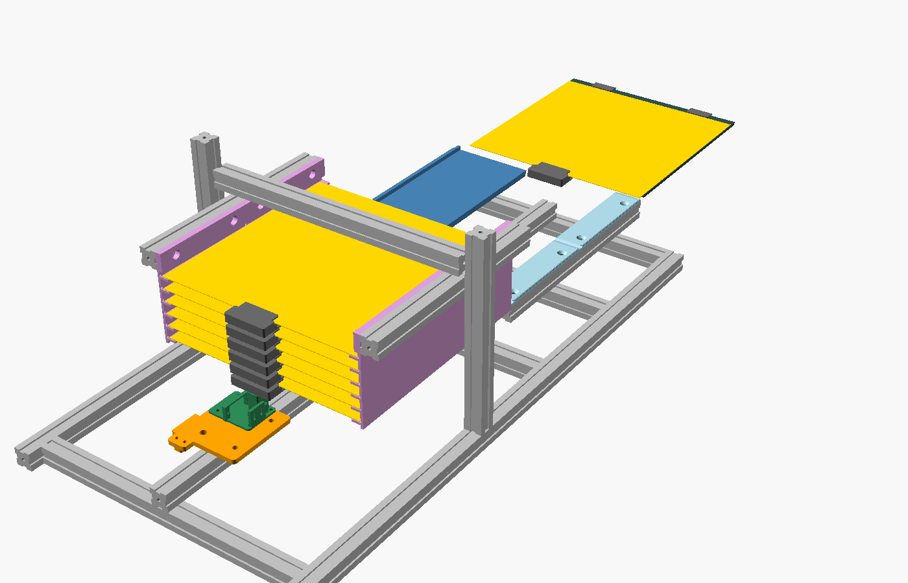
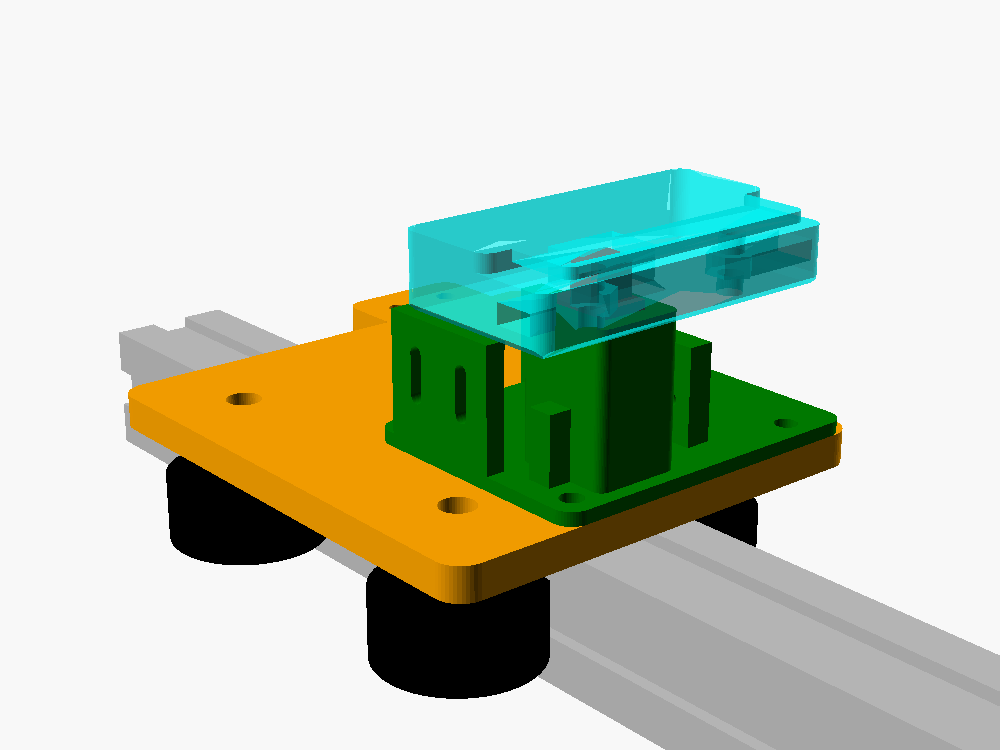

# Piezas impresas de la Estación de Cambio Frontal (ECF)

Diseños paramétricos en **OpenSCAD** (`.scad`) y sus **STL** listos para imprimir (`stl/`), ya orientados para imprimir sin soportes. Todos caben en la Ender 3 Pro (220 × 220 mm).



*Vista desde el lado HOME: a la izquierda el cargador con su ascensor; al fondo, la zona de descarga (volteador azul y riel derecho celeste) y la cama de la impresora en `Y=235`. Imagen generada con `ensamble.scad`.*

## Cómo regenerar los STL

```bash
brew install --cask openscad@snapshot     # macOS (en Windows: OpenSCAD "development snapshot")
cd cad
./generar_stl.sh                           # todas las piezas
./generar_stl.sh zapata                    # solo una
python3 tools/revisar_stl.py               # comprueba medidas y que quepan en la cama
```

Para cambiar una medida, edita `lib/comun.scad` (medidas compartidas) o la cabecera del `.scad` de cada pieza y vuelve a generar. Las más habituales:

| Variable | Archivo | Qué es |
| :--- | :--- | :--- |
| `placa_esp` | `lib/comun.scad` | Espesor real de tus placas PEI (0,5–0,75 mm) |
| `voladizo` | `lib/comun.scad` | Cuánto sobresale la placa (o su lengüeta) por delante de la cama |
| `cama_esp`, `base_mag` | `tope_trasero.scad` | Espesor del aluminio de la cama y de la base magnética |
| `paso_estante`, `niveles` | `lib/comun.scad` | Separación y número de placas del cargador |

> La altura de la cama de **tu** impresora **no** cambia las piezas: la estación se sube o baja con las patas niveladoras (ver la guía de armado, fase 7).

## Lista de piezas

**Cantidad total aproximada de filamento:** ~0,7 kg de **PETG** y ~80 g de **ABS o ASA**.

| # | STL | Cant. | Material | Ajustes | Dónde va |
| :---: | :--- | :---: | :--- | :--- | :--- |
| 1 | `zapata` | 1 por placa (7) + 1 | **ABS/ASA** | 0,2 mm, 4 perímetros, 40 % | Borde delantero de cada placa PEI (2 prisioneros M3 × 8 + 2 tuercas M3) |
| 2 | `tope_trasero` | 2 | **ABS/ASA** | 0,2 mm, 4 perímetros, 40 % | Borde trasero de la cama, a ±70 mm del centro (1 tornillo M3 × 12 + tuerca) |
| 3 | `carro_base` | 1 | PETG | 0,2 mm, 5 perímetros, 40 % | Carro del eje lineal: 4 ruedas en V (2 excéntricas), pinzas de correa |
| 4 | `carro_torre` | 1 | PETG | 0,2 mm, 4 perímetros, 40 % | Encima del carro (4 × M3 × 12): guía del dedo, cuna del servo MG90S, interruptor GANCHO_ENGANCHADO |
| 5 | `dedo_gancho` | 1 (+1) | PETG | 0,12 mm, 100 % | Corredera dentro de la torre |
| 6 | `eje_soporte_motor` | 1 | PETG | 0,2 mm, 4 perímetros, 30 % | NEMA 17 del eje lineal, travesaño `s = -110` |
| 7 | `eje_soporte_polea` | 1 | PETG | 0,2 mm, 4 perímetros, 30 % | Polea loca GT2 20T, travesaño `s = 535` |
| 8 | `riel_tapa` | 2 | PETG + cinta PTFE | 0,2 mm, 3 perímetros, 30 % | Encima del perfil derecho de la zona de descarga |
| 9 | `pedestal_riel` | 3 | PETG | 0,2 mm, 4 perímetros, 40 % | Sostienen el perfil derecho (travesaños 265, 400, 535) |
| 10 | `pedestal_bisagra` | 2 | PETG | 0,2 mm, 4 perímetros, 40 % | Ejes M5 del volteador (travesaños 265 y 535) |
| 11 | `volteador_mitad1` / `mitad2` / `union` | 1 c/u | PETG + cinta PTFE | 0,2 mm, 3 perímetros, 25 %, **borde (brim)** | Tapa basculante izquierda de la zona de descarga |
| 12 | `volteador_servo_soporte` | 1 | PETG | 0,2 mm, 5 perímetros, 50 % | Servo MG996R, travesaño `s = 400` |
| 13 | `volteador_servo_palanca` | 1 | PETG | 0,2 mm, 5 perímetros, 50 % | Disco del MG996R + rodillo 623ZZ |
| 14 | `peine_derecho` / `peine_izquierdo` | 2 c/u | PETG | 0,2 mm, 3 perímetros, 25 % | Paredes del cargador (6 estantes a 14 mm) |
| 15 | `ascensor_placa_derecha` / `izquierda` | 1 c/u | PETG | 0,2 mm, 5 perímetros, 40 % | Corren por los postes verticales (4 ruedas cada una) |
| 16 | `ascensor_soporte_tuerca` | 1 | PETG | 0,2 mm, 5 perímetros, 50 % | Tuerca T8 de brida, en la placa izquierda |
| 17 | `ascensor_soporte_motor` | 1 | PETG | 0,2 mm, 5 perímetros, 40 % | NEMA 17 con husillo T8 (paso 2 mm) |
| 18 | `soporte_final_carrera` | 2 | PETG | 0,2 mm, 4 perímetros | HOME del carro y del ascensor |
| 19 | `soporte_inductivo_cama` | 1 | PETG | 0,2 mm, 4 perímetros | Sensor inductivo M8 PLACA_EN_CAMA |
| 20 | `soporte_inductivo_descarga` | 1 | PETG | 0,2 mm, 4 perímetros | Sensor inductivo M8 PLACA_EN_DESCARGA |
| 21 | `caja_electronica` + `_tapa` | 1 c/u | PETG o PLA | 0,2 mm, 3 perímetros, 20 % | UNO + CNC Shield + LM2596 + Wagos |
| 22 | `pie_nivelador` | 6 | PETG | 0,2 mm, 4 perímetros, 50 % | Costado exterior de los largueros (patas M6): la base puede quedar de 0 a ~20 mm sobre la mesa |
| — | `calza_riel` | 0–4 | PETG | — | Solo si el riel lineal quedara bajo (ver la guía) |

Archivos de apoyo: `lib/comun.scad` (medidas comunes), `ensamble.scad` (vista del conjunto: cambia `dedo_s`, `u` y `abrir` para ver cada fase), `img/` (imágenes), `tools/revisar_stl.py`.

## Coordenadas y medidas clave

Todas las piezas de la estación usan el mismo sistema: **`s`** a lo largo de la estación (0 = HOME del carro, crece hacia la impresora), **`x`** a lo ancho (0 = riel lineal; `+x` = lado de la caja de descarga) y **`z`** vertical (0 = cara superior de la base de perfiles).

| Elemento | Posición |
| :--- | :--- |
| Plano de transferencia (las placas se deslizan aquí) | `z = 60` |
| Cara superior del riel lineal | `z = 20` |
| Travesaños de la base | `s = -110, 265, 400, 535` |
| Cargador (peines) | `s = 20 … 262`, estantes cada 14 mm |
| Zona de descarga | `s = 265 … 535` (volteador `s = 280 … 520`) |
| Postes del ascensor | `s = 141`, `x = ±165` |
| Posiciones del carro (dedo) | `s_mag = 15`, `s_drop = 275`, `s_bed = 530` |



*Carro: el dedo rojo sube dentro de la torre verde y entra en el bolsillo de la zapata (celeste). Las fuerzas al tirar y empujar las aguantan las paredes de la torre, no el servo.*

## Si quieres rediseñarlas con IA

En [PROMPTS_IA.md](PROMPTS_IA.md) hay un prompt para cada pieza (medidas, funciones, tolerancias y comprobaciones), listo para pedirle a una IA que genere el OpenSCAD, CadQuery o un modelo en otro programa.
