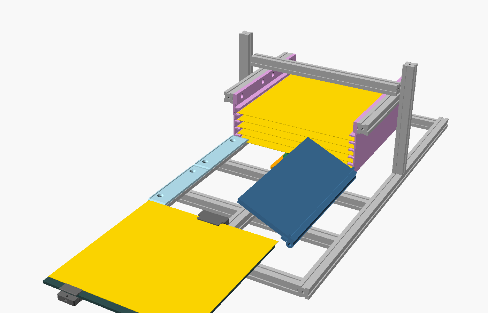

# Guía de armado — Estación de Cambio Frontal para Ender 3 Pro (v3)

Esta guía reemplaza a la sección 8 del [plan detallado](../PLAN_DETALLADO_AUTOSWAP_ENDER3PRO.md) y al tutorial antiguo (`legacy/`). Está pensada para alguien que **nunca ha armado electrónica**: todo se conecta con destornillador, conectores Wago y cables Dupont, **sin soldar**.

**Cómo usarla.** Sigue las fases en orden. Cada fase termina con una **✔ verificación**: no pases a la siguiente si falla. Tiempo total estimado: 3–5 fines de semana (más el tiempo de impresión, ~35 h).

| Necesitas | Dónde está |
| :--- | :--- |
| Lista de compras con precios | [BOM_ALIEXPRESS.md](BOM_ALIEXPRESS.md) |
| Piezas impresas (STL) y cómo imprimirlas | [cad/README.md](../cad/README.md) |
| Firmware de la estación | [firmware/station](../firmware/station) |
| App para macOS y Windows | [host/README.md](../host/README.md) |
| Plantillas del laminador | [slicer/README.md](../slicer/README.md) |


---

## Cómo funciona (en 1 minuto)

La estación se coloca **delante** de la impresora, a la altura de la cama. Tiene tres zonas, de la impresora hacia afuera:

1. **Zona de descarga.** Un riel a la derecha y una tapa basculante (**volteador**) a la izquierda. Al terminar una pieza, el carro tira de la placa usada hasta aquí; el volteador levanta el borde izquierdo y la placa (con la pieza) **resbala hacia la derecha a una caja**.
2. **Cargador.** Seis placas limpias, cada una en su **estante** (cada 14 mm). Un **ascensor** las baja de una en una hasta el plano de trabajo.
3. **Carro.** Corre por un riel central bajo todo lo anterior. Su **dedo** sube y entra en la **zapata** (pieza atornillada al borde de cada placa) para tirar de la placa usada o empujar la nueva hasta el **tope trasero** de la cama.

La impresora solo lleva la cama al frente (`Y=235`); el ordenador (app AutoSwap) coordina todo y comprueba cada paso con sensores. Si algo falla, la cola se pausa y la impresora queda segura.



### Sistema de coordenadas (lo verás en toda la guía)

- **`s`**: a lo largo de la estación, en mm. `s = 0` es la posición HOME del carro (extremo lejano) y crece hacia la impresora.
- **`x`**: a lo ancho. `x = 0` es el riel central; `+x` es el lado de la caja de descarga (derecha mirando hacia la impresora).
- **`z`**: altura sobre la cara superior de la base de perfiles. Las placas se deslizan a `z = 60` (**plano de transferencia**).

---

## Fase 0 — Seguridad, herramientas y mediciones

### 0.1 Reglas que no se rompen

> **⚠ Seguridad eléctrica y térmica**
> 1. No abras la fuente de la impresora ni toques cables de 110/220 V. La estación usa **su propio adaptador de 12 V**.
> 2. Conecta y desconecta cables **solo con todo desenchufado** (adaptador de 12 V fuera del enchufe **y** USB desconectado).
> 3. **Nunca conectes ni desconectes un motor paso a paso con el driver encendido**: el driver se destruye.
> 4. Los drivers tienen orientación: insertados al revés se queman (fase 7.2).
> 5. Rojo = positivo (+), negro = negativo (−). Respeta la polaridad en la fuente, el reductor, la shield y el capacitor.
> 6. **No alimentes los servos desde el Arduino**: los picos de corriente lo reinician o lo dañan.
> 7. **Imprimir sin supervisión es un riesgo de incendio**: firmware con protección térmica (fase 1.1), detector de humo cerca y supervisa las primeras colas completas.
> 8. La cama y la boquilla queman: trabaja con la impresora fría (< 30 °C) y desenchufada al tocar la cama.

### 0.2 Mide tu impresora

Completa la hoja del **Anexo A** del plan. Las tres medidas que más importan para esta guía:

| Medida | Para qué |
| :--- | :--- |
| **A3** — altura de la base magnética sobre la mesa con la cama en `Y=235` | Altura de la base de la estación: `h = A3 + 0,5 − 80` mm (de 0 a ~20 mm con las patas laterales). Si `h` sale **negativa**, pon la impresora sobre una tabla de MDF de ese grosor (por ejemplo, 15 mm) |
| **A4** — cuánto sobresale la cama por delante del chasis en `Y=235` | Si la cama **no** sobresale, el extremo de la estación tiene que pasar por encima del travesaño frontal de la impresora (ver fase 9.2) |
| **A8** — espesor de tus placas | Variable `placa_esp` de `cad/lib/comun.scad` (vuelve a generar las zapatas si no es 0,6 mm) |

### 0.3 Pruebas de fuerza (con la báscula colgante)

Haz las pruebas **T1, T2 y T3** de la sección 6.5 del plan. El carro empuja con ~20–35 N: si deslizar una placa sobre la base magnética (`F_desl`) cuesta **más de 20 N**, revisa la base magnética antes de seguir.

**✔ Verificación:** tienes A3, A4, A8 y `F_desl ≤ 20 N`.

---

## Fase 1 — Preparar la impresora

### 1.1 Firmware con protección térmica

1. Conecta la impresora por USB y abre un terminal serie a 115200 baudios (la app: `autoswap console --port <puerto>`, o Pronterface).
2. Envía `M115` y anota firmware y placa.
3. Si tienes la **placa 1.1.x con firmware de 2018**, actualiza el firmware (o cambia a una placa 4.2.x): algunas venían **sin protección contra fuga térmica** ("thermal runaway").

### 1.2 Cama rígida

1. Impresora apagada, desenchufada y fría. Retira la alfombrilla.
2. Desenrosca las 4 ruedas de nivelación, levanta la cama (sin tirar del cable) y quita los muelles.
3. Pon un **espaciador de silicona** en cada tornillo, baja la cama y enrosca las ruedas comprimiendo ~2 mm.

**✔** Al presionar una esquina, la cama no se hunde.

### 1.3 Zapatas en las placas

1. Imprime una **zapata** por placa en **ASA/ABS** (`cad/stl/zapata.stl`).
2. Mete 2 **tuercas M3** por los canales laterales y enrosca 2 **prisioneros M3 × 8** desde abajo, sin que asomen todavía.
3. Desliza la zapata sobre el borde delantero de la placa (en la lengüeta, si tu placa la tiene) **hasta que el borde toque la pared interior**, centrada (marca el centro con plumón).
4. Aprieta los prisioneros con la llave Allen de 1,5 mm: firmes, sin deformar la pieza.
5. Numera las placas con plumón (1, 2, 3...).

**✔** Prueba **T4**: tira de la zapata con la báscula hasta 3 × `F_desl`: no se mueve. Con el calibrador, la zapata sobresale **≤ 2 mm** por encima de la placa.

### 1.4 Topes traseros

1. Imprime 2 **topes traseros** en ASA/ABS.
2. Mete la tuerca M3 por el canal frontal y enrosca un tornillo M3 × 12 desde abajo.
3. Encaja cada tope en el borde trasero de la cama a **±70 mm del centro**, lejos de la salida del cable. Pon un trozo de cinta Kapton donde apoya el tornillo y aprieta con suavidad.

**✔** Con la impresora apagada, mueve la cama a mano por todo su recorrido: los topes no tocan el motor Y, el final de carrera ni el cable.

### 1.5 Placa en su sitio, nivelación y laminador

1. **Placas con lengüeta:** apoya la placa contra los topes traseros. **Placas sin lengüeta:** la placa queda adelantada (sobresale ~11 mm por delante de la cama), también contra los topes.
2. `G28` y nivela las 4 esquinas y el centro con una hoja de papel; imprime un cuadrado de una capa.
3. Configura el laminador con las plantillas de [slicer/](../slicer/README.md).
4. **Comprueba el ventilador:** lleva la boquilla a `X=117 Y=5 Z=0.2` con la placa puesta: el conducto del ventilador **no debe tocar la zapata** (debe pasar al menos una hoja de papel). Si toca, reduce el área de impresión por delante (slicer/README.md).

**✔** Primera capa correcta en **todas** las placas.

---

## Fase 2 — Imprimir las piezas

Lista completa, cantidades y ajustes en [cad/README.md](../cad/README.md). Orden recomendado (así puedes ir armando mientras imprimes):

1. `pie_nivelador` ×6, `pedestal_riel` ×3, `pedestal_bisagra` ×2 (base y descarga)
2. `carro_base`, `carro_torre`, `dedo_gancho` ×2, `eje_soporte_motor`, `eje_soporte_polea`
3. `riel_tapa` ×2, `volteador_mitad1`, `volteador_mitad2`, `volteador_union`, `volteador_servo_soporte`, `volteador_servo_palanca`
4. `peine_derecho` ×2, `peine_izquierdo` ×2, `ascensor_placa_derecha`, `ascensor_placa_izquierda`, `ascensor_soporte_tuerca`, `ascensor_soporte_motor`
5. `soporte_final_carrera` ×2, `soporte_inductivo_cama`, `soporte_inductivo_descarga`, `caja_electronica`, `caja_electronica_tapa`

> Imprime una pieza de prueba de cada tipo y compruébala con la pieza real (rueda, servo, perfil) antes de imprimir las repetidas.

---

## Fase 3 — Base de perfiles

### 3.1 Lista de cortes (perfil 2020)

| Cant. | Largo | Uso |
| :---: | :---: | :--- |
| 2 | 680 mm | Largueros de la base (izquierdo y derecho), `s = -135 … 545` |
| 4 | 310 mm | Travesaños, en `s = -110, 265, 400, 535` |
| 1 | 655 mm | Riel lineal central, `s = -120 … 535` |
| 1 | 270 mm | Riel derecho de la descarga, `s = 265 … 535` |
| 2 | 215 mm | Postes del ascensor |
| 2 | 245 mm | Perfiles de los peines (`s = 20 … 262`) |
| 1 | 296 mm | Arco del ascensor (une las dos placas del ascensor) |

### 3.2 Armado

1. Coloca los dos **largueros** paralelos con 330 mm entre sus centros (`x = ±165`).
2. Une los **4 travesaños** entre ellos con escuadras, tornillos M5 × 8 y tuercas en T, con sus **centros** en `s = -110, 265, 400 y 535` medidos desde el extremo HOME (el larguero empieza en `s = -135`).
3. Atornilla 6 **pies niveladores** a la **ranura lateral exterior** de los largueros (M5 × 10 + tuerca en T): cerca de las 4 esquinas y a la altura del travesaño `s = 265`. Enrosca las patas M6 hasta que la cara inferior de la base quede a la altura `h` calculada en la fase 0.2.
4. **Escuadra:** mide las dos diagonales del rectángulo; deben ser iguales con ±1 mm. Si no, afloja, empuja la esquina larga y aprieta.

**✔** El rectángulo no cojea sobre la mesa y las diagonales coinciden.

---

## Fase 4 — Eje lineal y carro

### 4.1 Riel y soportes

1. Atornilla el **riel lineal** (655 mm) encima de los travesaños, centrado (`x = 0`), del travesaño HOME (`s = -120`) al del lado de la impresora (`s = 535`), con escuadras.
2. Atornilla el **soporte del motor** sobre el travesaño HOME con su eje en `x = -48`, y el **soporte de la polea loca** sobre el travesaño `s = 535`, también en `x = -48` (el tramo de correa va al lado del riel, no encima).
3. Monta el **motor NEMA 17** boca abajo en su soporte (4 × M3 × 8) con la polea GT2 en el eje, dientes hacia abajo, y la **polea loca** con su tornillo M3 × 20.

### 4.2 Carro

1. Mete 2 **espaciadores excéntricos** en los agujeros grandes (lado `-x`) de `carro_base`, y espaciadores de 6 mm en los del lado `+x`.
2. Monta las 4 **ruedas** con tornillos M5 × 35 y tuercas autoblocantes.
3. Presenta el carro sobre el riel y **gira los excéntricos** con una llave de 8 mm hasta que el carro no tenga juego pero se deslice suave.
4. Atornilla la **torre** encima (4 × M3 × 12; las tuercas van en los alojamientos de abajo).
5. Mete el **dedo** en su canal: debe bajar solo por su peso. Si roza, lija el dedo, no el canal.
6. Coloca el **servo MG90S** tumbado en su cuna (pestañas contra la pared, 2 autorroscantes M2). **No pongas todavía el brazo del servo** (se hace en la fase 8).
7. Atornilla el **microinterruptor de rodillo** (GANCHO_ENGANCHADO) en el soporte de la derecha con 2 × M2: el rodillo debe quedar **1–2 mm por encima de la parte de arriba de la torre** (ajústalo con una zapata en la fase 9.3).

### 4.3 Correa

1. Pasa la correa GT2 alrededor de la polea del motor y de la polea loca (lazo horizontal, dientes hacia dentro).
2. Mete un extremo, desde abajo, en la **pinza trasera** del brazo del carro y el otro en la **pinza delantera**; asegura cada uno con una brida.
3. Tensa deslizando el motor en sus ranuras (hacia HOME) y aprieta los 4 tornillos: al pulsar la correa suena como una nota grave.

### 4.4 Sensor HOME

Atornilla un `soporte_final_carrera` con un microinterruptor al riel, en el extremo HOME, de modo que el carro lo pulse cuando el **dedo** está unos 15 mm antes del primer estante del cargador (`s ≈ 0`).

**✔** Con el motor desconectado, el carro recorre todo el riel a mano, suave y sin tirones, y pulsa el interruptor HOME al final.

---

## Fase 5 — Zona de descarga

1. Atornilla un **pedestal del riel** en cada travesaño `s = 265, 400, 535`, en `x = +110`, y encima el **riel derecho** (270 mm).
2. Pega **cinta de PTFE** en las dos **tapas del riel** y atorníllalas encima del riel derecho (lengüeta en la ranura, 2 × M5 avellanados por tapa): la ceja redondeada hacia fuera (`+x`).
3. Atornilla los dos **pedestales de bisagra** en los travesaños `s = 265` y `s = 535`, en `x = -128`, con un tornillo M5 × 30 en cada uno (cabeza por fuera, tuerca apretada por dentro).
4. Une las dos **mitades del volteador** con la pieza de unión (6 autorroscantes M3), pega PTFE en la superficie y encájalo entre los dos tornillos-eje. Debe girar libre y, cerrado, **apoyar sus orejas en las repisas** de los pedestales.
5. Atornilla el **soporte del servo MG996R** al travesaño `s = 400` (eje del servo en `x = -110`) y el servo con 4 tornillos. Fija la **palanca** al disco del servo con 2–4 autorroscantes y pon el **rodamiento 623ZZ** en la punta con un tornillo M3 × 10. **No la orientes todavía** (fase 8).
6. Monta un **sensor inductivo** en su `soporte_inductivo_descarga`, atornillado a la cara **interior** del riel derecho en `s ≈ 400`; ajusta sus tuercas M8 para que su cara quede **1–1,5 mm por debajo** del plano de las placas.
7. Monta el otro **sensor inductivo** en `soporte_inductivo_cama`, sobre el travesaño `s = 535` en `x = +60`, con la cara también 1–1,5 mm por debajo del plano: detecta el acero del borde de la placa asentada en la cama.
8. Coloca la **rampa** (cartón rígido o MDF de 3 mm) desde el borde de la tapa del riel derecho hasta la **caja de recogida** con espuma, a la derecha de la estación.

**✔** Una placa se desliza a mano sobre el volteador y el riel derecho sin engancharse; al levantar con la mano el borde izquierdo del volteador ~25°, la placa resbala hacia la caja.

---

## Fase 6 — Cargador con ascensor

1. Atornilla los dos **postes** (215 mm) verticales encima de los largueros, en `s = 141` (`x = ±165`), con 2 escuadras cada uno. Comprueba con la escuadra que quedan a 90°.
2. Monta 4 **ruedas** en cada **placa del ascensor** (excéntricos en el lado `-s`) y ajústalas al poste igual que el carro.
3. Atornilla a cada placa su **perfil de peine** (245 mm) por la cara exterior del perfil (2 × M5 por placa), paralelo a los largueros.
4. Atornilla los **peines** (dos tramos por lado) a la cara interior de cada perfil (2 × M5 por tramo, cabezas hacia dentro, arriba de todo): estantes hacia el centro, a la misma altura en ambos lados.
5. Une las dos placas por arriba con el **arco** (296 mm) y 2 escuadras.
6. Monta el **motor con husillo T8** en su soporte sobre el larguero izquierdo, en `s = 200`, y la **tuerca T8** en `ascensor_soporte_tuerca`, atornillado a la prolongación de la placa izquierda (2 × M3 × 20).
7. Monta un microinterruptor (HOME del ascensor) en lo alto del poste izquierdo, de modo que la placa lo pulse justo antes de llegar arriba.

**✔** Con el motor desconectado, gira el husillo con la mano: el conjunto sube y baja sin trabarse y los estantes de ambos lados quedan a la misma altura (mídelo con el calibrador).

---

## Fase 7 — Electrónica (sin soldar)

### 7.1 Conceptos rápidos

- **GND (tierra común):** todos los negativos van al mismo Wago "GND".
- **Final de carrera:** se conectan las patas **C** (común) y **NO** (normalmente abierto). Pulsado = señal a GND.
- **Sensor inductivo (3 cables):** marrón = +12 V, azul = GND, negro = señal (pasa a GND cuando detecta metal).
- **Servo:** marrón/negro = GND, rojo = +5,5 V, naranja/amarillo = señal.

### 7.2 CNC Shield y drivers

1. Cinta aislante sobre la carcasa metálica del USB del Arduino; monta la CNC Shield encima, alineando todos los pines.
2. **Micropasos:** con **TMC2209** no pongas jumpers bajo los zócalos X e Y (8 micropasos). Con **A4988**, pon los 3 jumpers (16 micropasos) y luego ajusta en la estación `steps_per_mm 80` y `lift_steps_per_mm 1600`.
3. Inserta un driver en el zócalo **X** (carro) y otro en el **Y** (ascensor), con el pin **EN** del driver junto a la marca **EN** del zócalo. **Al revés se destruye.**
4. Pega los disipadores.

### 7.3 Reductor a 5,5 V (antes de conectar los servos)

1. Fuente de 12 V → adaptador de jack → Wago "+12V" (pasando por el **portafusibles de 3 A**) y Wago "GND".
2. Wago "+12V" → `IN+` del LM2596; Wago "GND" → `IN−`.
3. Enchufa y gira el potenciómetro hasta que la pantalla marque **5,5 V**; confírmalo con el multímetro. Desenchufa.

### 7.4 Corriente de los drivers (Vref)

Motores desconectados, Arduino por USB y 12 V en la shield. Multímetro en V⎓ (negro al borne `−` de la shield, rojo a la cabeza del potenciómetro del driver). Objetivo **0,8 A**:

- **TMC2209** (BIGTREETECH): `Vref ≈ 1,41 × I` → **≈ 1,1 V**
- **A4988** (resistencia `R100`): `Vref = 8 × I × 0,1` → **≈ 0,64 V**

Desenchufa todo antes de conectar los motores.

### 7.5 Tabla de conexiones

Haz las conexiones **en este orden y con todo desenchufado**.

| # | Desde | Hasta | Nota |
| :---: | :--- | :--- | :--- |
| P1 | Fuente 12 V (+) | Fusible 3 A → Wago "+12V" | Rojo 18 AWG |
| P2 | Fuente 12 V (−) | Wago "GND" | Negro 18 AWG |
| P3 | Wago "+12V" / "GND" | Borne de potencia `+` / `−` de la CNC Shield | **¡Polaridad!** |
| P4 | Wago "+12V" / "GND" | LM2596 `IN+` / `IN−` | |
| P5 | LM2596 `OUT+` (5,5 V) / `OUT−` | Wago "+5V5" / Wago "GND" | |
| S1 | Wago "+5V5" / "GND" | Rojo / marrón de los **dos servos** | Nunca al 5 V del Arduino |
| S2 | Señal del **servo del gancho (MG90S)** | **SpnEn** (Arduino D12) | Por la cadena portacables, con extensión |
| S3 | Señal del **servo del volteador (MG996R)** | **CoolEn** (Arduino A3) | |
| S4 | Capacitor 1000 µF | Entre Wago "+5V5" (pata larga) y "GND" (franja) | Opcional, recomendado |
| M1 | Motor del **carro** | Conector del eje **X** (`2B 2A 1A 1B`) | Pares de bobinas identificados con el multímetro |
| M2 | Motor del **ascensor** | Conector del eje **Y** | |
| L1 | HOME del carro (C y NO) | **X−** (D9) y GND | |
| L2 | HOME del ascensor (C y NO) | **Y−** (D10) y GND | |
| L3 | Sensor inductivo **PLACA_EN_CAMA** | Marrón → "+12V", azul → "GND", negro → **diodo 1N4148** (franja hacia el cable negro) → **Z−** (D11) | Ver nota del diodo |
| L4 | Sensor inductivo **PLACA_EN_DESCARGA** | Igual, con su diodo → **Abort** (A0) | |
| L5 | Interruptor **GANCHO_ENGANCHADO** del carro (C y NO) | **Hold** (A1) y GND | Por la cadena portacables |
| L6 | Botón **STOP** (contacto **NC**) | **Resume** (A2) y GND | Si no lo pones aún: `CFG SET inv_mask 0` |
| U1 | USB del Arduino | Ordenador | Cable A–B |
| U2 | USB de la impresora | Ordenador | Cable de datos |

> **El diodo de los sensores inductivos.** Los sensores funcionan a 12 V y algunos llevan una resistencia interna que pondría 12 V en la entrada del Arduino (que admite 5 V). El diodo 1N4148 en serie (franja = cátodo hacia el cable negro del sensor) deja pasar la señal "detecta" (el pin baja a ~1 V) y bloquea los 12 V.

### 7.6 Revisión antes de energizar

- [ ] Drivers con **EN** junto a **EN**.
- [ ] Rojo al `+` y negro al `−` en la shield, el reductor y la fuente.
- [ ] Reductor medido en **5,5 V** antes de conectar los servos.
- [ ] Ningún servo conectado al 5 V del Arduino.
- [ ] Todos los negativos en el Wago "GND"; diodos de los sensores con la franja hacia el sensor.
- [ ] Tira suavemente de cada cable: ninguno se suelta.
- [ ] No hay cobre pelado tocando otro cable ni el aluminio.

Monta todo en la **caja de la electrónica** y atorníllala a un larguero.

---

## Fase 8 — Firmware y app

### 8.1 Instalar (macOS)

```bash
xcode-select --install
/bin/bash -c "$(curl -fsSL https://raw.githubusercontent.com/Homebrew/install/HEAD/install.sh)"
brew install python@3.12
git clone https://github.com/ASolisEk/AutoSwapEnder3Pro.git
cd AutoSwapEnder3Pro
python3.12 -m venv .venv && source .venv/bin/activate
pip install -e "./host[gui]" platformio
```

### 8.2 Instalar (Windows, PowerShell)

```powershell
winget install -e --id Python.Python.3.12
winget install -e --id Git.Git
git clone https://github.com/ASolisEk/AutoSwapEnder3Pro.git
cd AutoSwapEnder3Pro
py -3.12 -m venv .venv
Set-ExecutionPolicy -Scope CurrentUser RemoteSigned
.\.venv\Scripts\Activate.ps1
pip install -e ".\host[gui]" platformio
```

### 8.3 Cargar el firmware de la estación

```bash
cd firmware/station
pio run -e uno -t upload              # si hay varios puertos: --upload-port /dev/cu.usbmodem14101 (o COM5)
pio device monitor -b 115200          # escribe: hello  (Enter)
```

Debe responder `0 OK AUTOSWAP-STATION fw=0.2.0 proto=2`. Sal con `Ctrl+C`.

---

## Fase 9 — Primer encendido y calibración

Usa la app gráfica (`autoswap-gui`, pestaña **Estación** y **Asistente**) o la línea de órdenes (`autoswap station ...`). En los ejemplos se usa la consola: `autoswap console --port <puerto de la estación>`.

### 9.1 Solo USB (sin 12 V): sensores

1. Envía `status`. Pulsa cada interruptor con la mano y acerca un trozo de placa a cada sensor inductivo: su valor (`sw=`, `bed=`, `drop=`, `eng=`) debe cambiar.
2. Si alguno sale **al revés**, súmale su bit en `inv_mask` (HOME 1, HOME ascensor 2, cama 4, descarga 8, gancho 16, STOP 32): por ejemplo `cfg set inv_mask 36` y `cfg save`.

### 9.2 Con 12 V: servos

1. Enchufa la fuente. Envía `hook down` y coloca el **brazo del MG90S** de modo que el tornillo M2 (pasador) entre en la ranura del dedo con el **dedo abajo**. Envía `hook up` / `hook down`: el dedo sube 8 mm y baja. Ajusta `hook_up_deg` / `hook_down_deg` si hace falta.
2. Envía `flap close` y orienta la **palanca** del MG996R horizontal hacia `+x` (sin tocar el volteador). Envía `flap open`: la palanca sube, levanta el volteador ~25–35° y vuelve con `flap close`. Ajusta `flap_open_deg` / `flap_closed_deg`.

### 9.3 Motores y HOME

1. `move 10`: el carro avanza 10 mm **hacia la impresora**. Si va al revés: `cfg set dir_mask 1` (carro) o `2` (ascensor); `cfg save`.
2. `home`: el carro va a su interruptor, se aparca en `s_park` y el ascensor sube a su tope y baja al nivel 0.
3. Calibra los pasos: `goto 100` y luego `goto 200`; mide con la regla lo que avanzó y corrige `steps_per_mm = actual × 100 / medido`.
4. Ajusta el rodillo de GANCHO_ENGANCHADO: con una zapata (suelta) apoyada encima de la torre, `status` debe dar `eng=1`; sin ella, `eng=0`.

### 9.4 Alinear con la impresora

1. Haz `G28` en la impresora y lleva la cama a `Y=235` con una placa asentada contra los topes.
2. Acerca la estación por delante, **centrada** con la cama (el riel central bajo el centro de la zapata), con **10–12 mm** entre el final de las tapas y el borde de la cama.
3. **Altura:** con las patas, deja la superficie del volteador y de las tapas **0,3–0,8 mm por encima** de la base magnética. Apoya una regla metálica sobre la tapa y mide con galgas el hueco hasta la base magnética.
4. Si tu cama **no sobresale** del chasis en `Y=235` (medida A4), separa la estación lo necesario y comprueba que nada de ella toque el travesaño frontal ni la pantalla de la impresora.
5. Une la estación a la mesa (cinta de doble cara o topes) para que no se mueva.

**✔** Con la impresora apagada, mueve la cama a mano de `Y=0` a `Y=235`: nada de la estación toca la cama ni la zapata.

### 9.5 Posiciones del carro

1. **`s_bed`:** con la placa asentada y la cama en `Y=235`, mueve el carro (`goto`, `move`) hasta que el dedo quede justo bajo el bolsillo de la zapata; `hook up` debe entrar sin forzar. `status` → `pos=` → `cfg set s_bed <pos>`; `hook down`.
2. **`lift_zero_mm`:** con placas en el cargador, `lift home` y luego `lift move 1` (o `-1`) hasta que la **cara superior de la placa de abajo** quede al nivel de la tapa del riel (regla apoyada en ambas). `status` → `lift=` → `cfg set lift_zero_mm <lift>`.
3. **`s_mag`:** `lift level 0`, mueve el carro bajo la zapata de esa placa (`hook up` entra). `cfg set s_mag <pos>`.
4. **`s_drop`:** por defecto `s_bed − 255`. Comprueba que, con la placa tirada hasta ahí, queda entera sobre la zona de descarga y el sensor de descarga marca `drop=1`.
5. `cfg save`. En la app: pestaña **Asistente → Guardar posición como...** hace lo mismo con un clic.

---

## Fase 10 — Pruebas

1. **En banco** (recomendado): antes de acercar la estación a la impresora, pon una placa sobre una tabla con base magnética a la misma altura y prueba `eject` y `load` a mano.
2. **Ciclos sin imprimir:** `autoswap test-swap --cycles 20 --report prueba.csv` (o **Asistente → Ejecutar ciclos de prueba**). Cuando el cargador se vacía, la app te pide devolver las placas de la caja al cargador. Objetivo: **20 de 20**.
3. **Primera cola supervisada:** 3 trabajos de un cuadrado de 20 × 20 × 5 mm en PLA: `autoswap queue cuadro.gcode --copies 3`.
4. **Fiabilidad:** 50 ciclos con ≥ 98 % de éxito antes de dejar colas largas sin supervisión.

**✔** Lista final:

- [ ] Firmware de la impresora con protección térmica.
- [ ] Cama rígida y nivelada; primera capa correcta en todas las placas.
- [ ] Zapatas firmes (T4); topes traseros sin interferencias.
- [ ] Estación alineada (altura, centrado, separación) y fija.
- [ ] Todos los sensores responden y no están invertidos.
- [ ] 20 ciclos de prueba sin fallos; botón STOP probado.
- [ ] Detector de humo instalado cerca de la impresora.

---

## Uso diario

1. **Cargar placas:** con el ascensor arriba (`lift level 0`), mete las placas limpias **desde el extremo HOME**, empezando por el **estante de abajo**, con la zapata hacia HOME (hacia ti). Indica cuántas pusiste en la app.
2. **Lanzar una cola:** pestaña **Cola** → añade los `.gcode` (laminados con las plantillas) → copias → **Iniciar**. O: `autoswap queue pieza.gcode --copies 6 --plates 6`.
3. **Durante la cola** el ordenador no se suspende (la app lo evita). Si algo falla, la cola se pausa y te avisa (escritorio y, si lo configuras, al móvil con [ntfy](https://ntfy.sh): `autoswap config set notifications.ntfy_topic=mi-tema`).
4. **Al terminar:** vacía la caja; las piezas se despegan solas cuando la placa se enfría (flexiona la placa si hace falta). Limpia las placas con alcohol isopropílico.
5. **Mantenimiento mensual:** revisa la cinta de PTFE, el apriete de las zapatas, la tensión de la correa y que las ruedas no tengan juego.

## Problemas frecuentes

| Síntoma | Causa probable | Solución |
| :--- | :--- | :--- |
| `E16 HOOK_MISS` al expulsar | `s_bed` mal calibrado o la placa no está contra los topes | Recalibra `s_bed` (9.5) |
| `E06 MAGAZINE_EMPTY` con placas en el cargador | `lift_zero_mm` o `s_mag` mal calibrados; el estante no está a nivel | Recalibra 9.5 pasos 2–3 |
| `E08 DROP_JAM` | La placa no resbaló: ángulo pequeño, PTFE gastado o caja llena | Sube `flap_open_deg`, cambia la cinta, vacía la caja |
| `E09 SEAT_FAIL` | La placa nueva no llegó a los topes o el sensor de cama está bajo | Revisa altura del plano (9.4) y la distancia del sensor inductivo (1–1,5 mm) |
| La placa choca con el borde de la cama al cargar | Estación más baja que la cama | Sube las patas hasta 0,3–0,8 mm por encima |
| El carro vibra pero no avanza | Vref bajo, bobinas mal emparejadas o rueda excéntrica muy apretada | Revisa 7.4 y 4.2 |
| El ascensor baja solo con la estación apagada | Husillo de paso 8 | Usa husillo T8 × 2 o `cfg set idle_disable 0` |
| Un sensor siempre activo | Lógica invertida o cableado en NC | `inv_mask` (9.1) o pasa el cable a NO |

Más casos en la sección 11 del [plan](../PLAN_DETALLADO_AUTOSWAP_ENDER3PRO.md).
